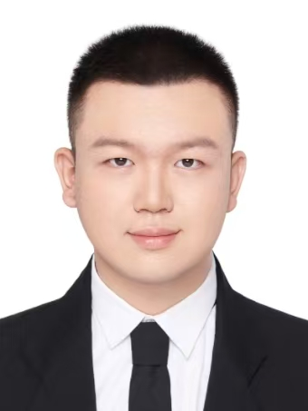
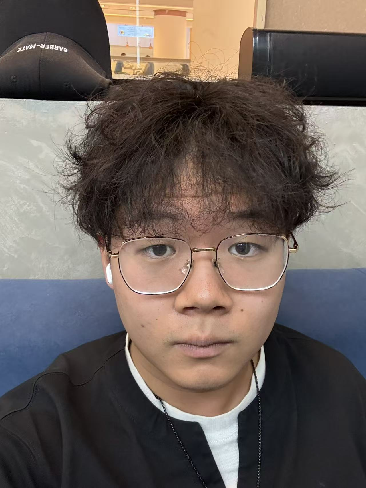
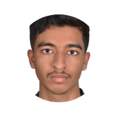
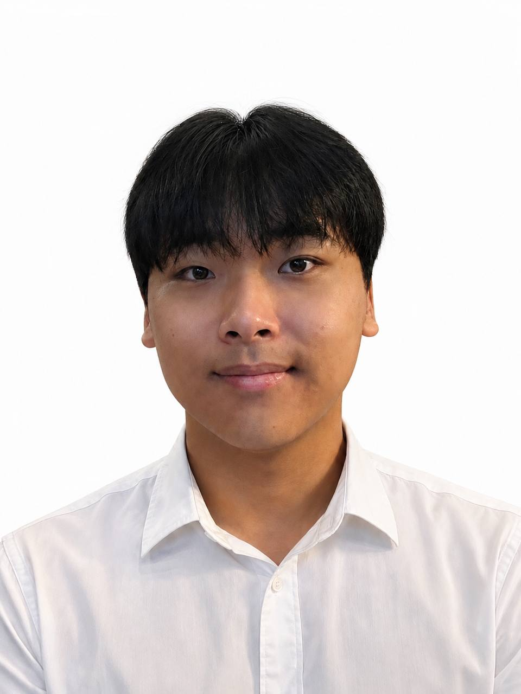
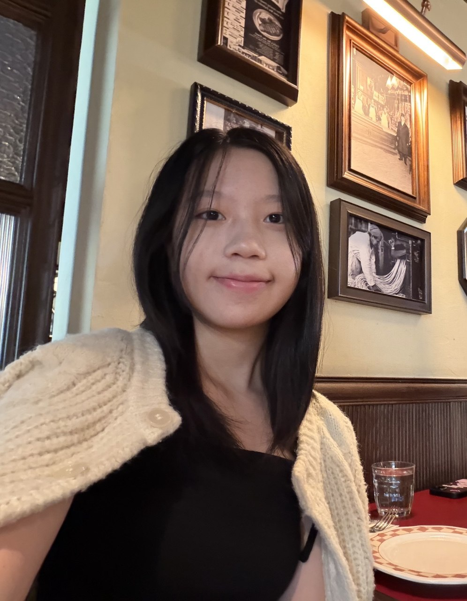
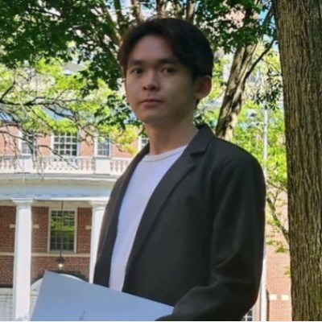

# About Us

We are a team based in the [School of Computing, National University of Singapore](http://www.comp.nus.edu.sg).

## Project team

### Pei Teer

[[github](https://github.com/peterpei666)]

* Role: Developer
* Responsibilities: Edit fields, navigating command history

### Zhang Ruixuan

[[github](https://github.com/zruixuan)]

* Role: Developer
* Responsibilities:

### Almarzooq Abdulaziz Moayad A

[[github](http://github.com/aziz-Almarzooq)]

* Role: Developer
* Responsibilities: View previously added Contacts, track each contact's latest update date.

### Hyunmin Lee

[[github](http://github.com/hyunmin1211)]

* Role: Developer
* Responsibilities: UI

### Selene Chan

[[github](http://github.com/sel-couth-ene)]

* Role: Developer
* Responsibilities: Data

### Ray

[[github](https://github.com/RayWHJ)]

* Role: Developer
* Responsibilities: Command Logic

