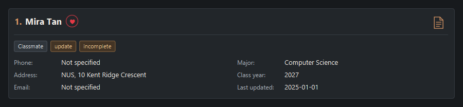

# UniMate User Guide

UniMate helps **university students organise classmates, project teammates, tutors and professors** in one desktop contact list. Record a contact's major and class year, group people with tags, keep notes and mark favourites so you can find the right person when you need them.

You work by typing commands into a **command box**; the contact cards and messages show the results. This suits students who prefer typing to navigating menus. No programming knowledge is needed: this guide explains the command format and gives examples you can adapt.

This guide covers the current application. Start with [Quick start](#quick-start), or use the task links below when you know what you want to do.

| I want to... | Go to |
| --- | --- |
| Add someone or correct their details | [Add](#adding-a-person-add), [field rules](#contact-field-reference), [edit](#editing-a-person-edit) |
| Find classmates or arrange the list | [Find](#locating-persons-by-name-major-or-class-year-find), [filter](#filtering-contacts-by-major-class-year-and-tag-filter), [sort](#sorting-contacts-by-name-major-class-year-or-update-date-sort) |
| Group contacts or keep follow-up details | [Tags](#adding-tags-to-a-person-tag), [favourites](#marking-a-favourite-contact-fav), [notes](#adding-or-replacing-a-contact-s-note-note) |
| Understand symbols on a contact card | [Contact indicators](#reading-contact-indicators) |
| Recover a change or resolve a save error | [Undo](#undoing-a-change-undo), [redo](#redoing-an-undone-change-redo), [saving](#saving-the-data) |
| Look up a command quickly | [Command summary](#command-summary) |

<!-- * Table of Contents -->
<page-nav-print />

--------------------------------------------------------------------------------------------------------------------

## Quick start

1. Ensure that Java `25` or later is installed. In a terminal, run `java --version` to check.<br>
   **Mac users:** Follow the [Java installation instructions](https://se-education.org/guides/tutorials/javaInstallationMac.html) for your platform.

1. Download the latest `.jar` file from the [UniMate releases page](https://github.com/AY2627S1-CS2103T-F15-3/tp/releases).

1. Put the file in a folder you want to use for UniMate. This is your **home folder**: keep the app and its data here.

1. Open a terminal, use `cd` to enter that folder, then run `java -jar unimate.jar`.<br>
   Use the downloaded filename if it differs from `unimate.jar`. Always launch from this same folder so UniMate loads the same contacts.

1. The window opens with sample contacts if no data file exists. The screenshot below shows the command box at the top, the message area below it, the list status and the numbered contact cards.

   

### Try your first commands

Click the command box, type one command and press **Enter**. Follow these steps in order; they create and then remove only a demonstration contact. Use a different unused name if `UniMateDemo` already exists. If other contacts also match the search, replace `1` in step 3 with the number on the demo card.

| Step | Command | What you should see |
| --- | --- | --- |
| 1. Add a contact | `add n/UniMateDemo e/ugdemo@example.com a/NUS` | `New person added:` and a new card. The phone is `Not specified`; an email is enough to avoid the `incomplete` reminder. |
| 2. Locate it | `find UniMateDemo` | The demo contact in the results. Confirm its name and current number; normally this is `1`. |
| 3. Add its major | `edit 1 m/Computer Science` | `Edited person:` and the updated major. The full list returns, so the contact may have a different number. |
| 4. Revert the edit | `undo` | The demo contact's major returns to `Not specified`. |
| 5. Revert the addition | `undo` | The demo contact disappears; your original contacts remain. |
| 6. View your contacts | `list` | All saved contacts and the total count. |

A shared email may also produce an amber [duplicate-details warning](#shared-phone-and-email-warnings); the addition still succeeds. If a command shows an error, correct it before continuing. For a saving error, follow [Saving the data](#saving-the-data).

Use `help` for the guide link or `exit` to close UniMate. Keep [the command summary](#command-summary) handy as you explore.

--------------------------------------------------------------------------------------------------------------------

## Using the contact list

| Part of the window | How to use it |
| --- | --- |
| Command box | Type a command and press Enter. Successful commands clear the box; errors keep the input for correction. |
| Message area | Read the result or error. Long messages wrap and can be scrolled; the next command replaces the message. |
| Status above the cards | Check how many contacts are shown, the active search or filter, and the sort order. |
| Numbered contact cards | Use the number currently beside a name for commands such as `edit 1`. A search, filter or sort can change these numbers. |
| Data-file path at the bottom | Check which file stores the contacts for this session. See [Saving the data](#saving-the-data). |

Contact details appear in two columns when the window is wide enough. In a narrow window, the academic
fields move below the phone, address and email fields.

* Long names and field values show `...` when they cannot fit. Click a shortened value to expand it,
  then click again to collapse it. This also applies to shortened tags.
* Use the scrollbar on the right of the contact list to reach other contacts or the bottom of an
  expanded card. Drag the thumb or use its arrow buttons for smaller movements.
* Expanding a value changes only its display; the saved contact details remain unchanged.
* Expanded values stay open while scrolling or resizing. Changing a contact resets its expanded
  values; restarting the app also resets expansion. A command that leaves the contact unchanged
  keeps its expansion state.

### Reading contact indicators

The example card below shows how the indicators can appear together. Mira has a saved note and is a favourite, but has neither phone nor email and has an old update date. The screenshot uses an example review date of 28 October 2026.



| Indicator | Meaning | What to do |
| --- | --- | --- |
| Red heart beside the name | A favourite contact | Use [fav / unfav](#marking-a-favourite-contact-fav) to change it. |
| Orange note icon at the top right | A note is saved | Use [shownote INDEX](#viewing-a-contact-s-note-shownote) to read it. |
| Grey tag, such as `Classmate` | A category you assigned | Use [tag / untag](#adding-tags-to-a-person-tag) to manage categories. |
| Amber `incomplete` | Both phone and email are missing | [Edit](#editing-a-person-edit) either contact method to remove it. |
| Amber `update` | Basic details were last changed more than a calendar year ago | Review the details and correct any outdated information with [edit](#editing-a-person-edit). |

The amber reminders are automatic; they are separate from your tags. See [incomplete reminders](#automatic-incomplete-reminders) and [update reminders](#automatic-update-reminders) for the full rules.

### Keyboard navigation

| Key | Action |
| --- | --- |
| Tab from the command box | Focus the contact list, keeping the selection or selecting the first contact. |
| Up / Down while the list is focused | Select the previous / next contact. The selected card has an orange border. |
| Tab from the list | Focus the selected contact's first expandable value. If none exist, return to the command box. |
| Tab from an expandable value | Focus the next expandable value on that contact; after the last, return to the command box. |
| Shift+Tab from the command box | Focus the selected contact's last expandable value, or the list if none exist. |
| Shift+Tab from an expandable value | Focus the previous expandable value; before the first, return to the list. |
| Shift+Tab from the list | Return to the command box. |
| Enter / Space on an expandable value | Expand or collapse that value. |

Expandable values, including long tags, have an orange dotted outline when focused. Their order is:
name, tags from left to right, phone, address, email, major, class year, last updated. Short values and
other contacts are skipped. The list scrolls to keep the focused value visible; for a value taller
than the viewport, it shows the start of that value. With an empty list, Tab and Shift+Tab keep focus
in the command box.
Up/Down in the command box still recalls command history.

--------------------------------------------------------------------------------------------------------------------

## Features

<box type="info" seamless>

**Notes about the command format:**<br>

* Command words are case-insensitive: `tag`, `TAG` and `Tag` select the same command. This applies to all commands.<br>
  Parameter prefixes remain case-sensitive: use `t/`, not `T/`. Values retain their original capitalization.
  Sorting keywords also ignore case: `SORT Name ASC` works like `sort name asc`.

* Words in `UPPER_CASE` are the parameters to be supplied by the user.<br>
  For example, in `add n/NAME`, replace `NAME` with a value such as `John Doe`.

* Items in square brackets are optional.<br>
  For example, `n/NAME [t/TAG]` can be used as `n/John Doe t/friend` or as `n/John Doe`.

* Items followed by `...` can appear zero or more times.<br>
  For example, `[t/TAG]... ` may be omitted, or written as `t/friend` or `t/friend t/family`.

* Put the command word first and, when required, `INDEX` next. Prefixed fields may follow in any order. For `sort`, the field must precede the direction.<br>
  For example, if the command specifies `n/NAME p/PHONE_NUMBER`, `p/PHONE_NUMBER n/NAME` is also acceptable.

* Extraneous parameters for `help`, `exit`, and `clear` are ignored.<br>
  For example, `help 123` is interpreted as `help`.

* `list`, `listfav`, `tags`, `undo` and `redo` take no parameters and reject extra arguments.<br>
  In particular, `list all` is rejected; use plain `list` to show all saved contacts.
  See [Listing all persons](#listing-all-persons-list) for details.

* If you are using a PDF version of this document, be careful when copying and pasting commands that span multiple lines as space characters surrounding line-breaks may be omitted when copied over to the application.
</box>

### Choosing the right contact number

`INDEX` means the number **currently shown beside a contact's name**, starting at `1`. For example, `edit 2 p/91234567` changes the second displayed contact, even in search results. It is not a permanent contact ID.

Always check the name and number after a search, filter, sort or contact change. A successful `add`, `edit`, `undo` or `redo` returns to the full list, so a number from the previous results may identify someone else. Run the search or filter again before your next indexed command.

Examples in separate command sections are independent. Before trying one, ensure the required contacts exist and use their current displayed numbers. An `add` example requires a name not already saved.

### Contact field reference

Use these rules when adding or editing contacts. A **prefix** identifies the field: for example, `p/91234567` supplies a phone number. Put a space before each prefix. Do not type the capitalised placeholders or square brackets from a format line.

| Prefix | Rules and example |
| --- | --- |
| `n/NAME` | Required for `add`. English letters, digits and spaces; cannot be blank. Apostrophes and hyphens are not accepted. Names are unique ignoring case. Example: `n/Alex Tan`. |
| `p/PHONE_NUMBER` | Optional. At least 3 digits, with no spaces, `+` sign or punctuation. Example: `p/91234567`. |
| `e/EMAIL` | Optional. A valid email following the rules below. Example: `e/alex+cs@example.com`. |
| `a/ADDRESS` | Required for `add`. Non-blank text containing a visible character. Example: `a/10 Kent Ridge Road`. |
| `m/MAJOR` | Optional. Non-blank text on one line. Example: `m/Computer Science`. |
| `c/CLASS_YEAR` | Optional. Exactly 4 digits from `2000` to `2099`, representing the graduation year. Example: `c/2027`. |
| `t/TAG` | Optional in `add` and `edit`; repeat for multiple tags. English letters and digits only; no spaces or punctuation. Case-sensitive: `Friend` and `friend` are separate tags. Example: `t/ProjectTeam`. |
| `d/DEFAULT_INDEX` | A default tag number from `1` to `5`, used with `add` or `tag`. Repeat for multiple tags. See [the default tag list](#listing-default-tags-tags). Example: `d/2` adds `Classmate`. |
| `f/` | An optional flag in `add`, with no value. Use [fav / unfav](#marking-a-favourite-contact-fav) after creation. |

**Email rules:** The part before `@` allows letters, digits and `+ _ . -`. Special characters cannot be consecutive or at either end: `alex+cs@example.com` is valid; `alex++cs@example.com` is not. The domain uses letters, digits and hyphens in labels separated by dots; each label starts and ends with a letter or digit, and the final label has at least 2 characters.

**Omitting and clearing fields:** In `add`, omit an unknown optional field; an empty supplied value such as `p/` is rejected. In `edit`, omitted fields keep their values. To clear an optional field, give its prefix without a value, such as `edit 1 p/ e/ m/ c/`. Use `edit 1 t/` to clear all tags. Name and address cannot be cleared. Except for repeated `t/` and `d/` where supported, each prefix may appear only once.

### Viewing help: `help`

Opens a help window containing the online User Guide address. Click **Copy URL**, then paste it into your web browser to open the guide. You can also open this window with **F1** or the **Help** menu.


Format: `help`


### Adding a person: `add`

Creates a contact. Only name and address are required; use the [field reference](#contact-field-reference) for valid values and optional fields.

Format: `add n/NAME [p/PHONE_NUMBER] [e/EMAIL] a/ADDRESS [m/MAJOR] [c/CLASS_YEAR] [f/] [t/TAG]... [d/DEFAULT_INDEX]...`

#### Details and favourites

* Omit unknown optional fields. If both phone and email are omitted, the contact shows the automatic [incomplete reminder](#automatic-incomplete-reminders).
* A contact can have any number of tags, including none. Use `t/TAG` for a custom tag or `d/DEFAULT_INDEX` for a [default tag](#listing-default-tags-tags).
* Include `f/` anywhere among the prefixed fields to create a favourite with a red heart. It may appear only once and takes no value: `f/true`, `f/false` and `f/3` are rejected. Without it, the new contact is not a favourite.
* After creation, use [fav / unfav](#marking-a-favourite-contact-fav) to change favourite status. `edit` preserves that status.

#### Results and duplicates

* Success shows `New person added:` followed by the contact's details, or `New favourite contact added:` when `f/` was supplied. The full list appears in the active sort order and the command box clears.
* A different name with a shared phone or email is added with an extra [warning](#shared-phone-and-email-warnings). Check the matching cards to decide whether the shared details are intentional.
* A name already saved is rejected, ignoring case: `John Doe` and `john doe` identify the same contact even if their other details differ. The error includes the existing contact's details; contacts, the current view and undo/redo history stay unchanged.
* If the duplicate is visible, `Existing contact at displayed index N:` identifies its current card number. If hidden, the error gives a **saved index** and tells you to run `list`, then `sort reset`. Follow those steps and check the card before using that number.
* A successful addition, including favourite status and tags, is one [undo](#undoing-a-change-undo) step. Data is saved automatically; see [saving errors](#saving-the-data) if an error appears.

<box type="warning" seamless>

**Check field prefixes:** Unknown prefix-like text may become part of the preceding field. For example, `add n/PrefixProbe a/NUS x/typo` saves `NUS x/typo` as the address. Check the card after adding it; `find PrefixProbe`, followed by `edit 1 a/NUS` after confirming the result, corrects this example.

A recognised prefix preceded by a space starts a new field. In `add n/Alice a/Block f/`, `f/` marks a favourite and the address is `Block`. `add n/Alice a/Blockf/3` keeps the full address `Blockf/3`. A space followed by `f/` is reserved for the flag and cannot be literal address text in `add`.
</box>

#### Examples

| Command | Result |
| --- | --- |
| `add n/Alice a/NUS` | Adds Alice without phone or email; her card shows `incomplete`. |
| `add n/Alex Tan p/91234567 e/alex@example.com a/NUS m/Computer Science c/2027 d/2 f/` | Adds a favourite with academic details and the `Classmate` tag. |
| `add n/Study Partner p/91234567 a/NUS t/ProjectTeam` | After the Alex example, adds another contact and warns that Alex shares the phone number. One `undo` removes only Study Partner. |

### Shared phone and email warnings

Different people may share a phone number or email address. `add` and `edit` allow this and append a warning to their normal success message, for example:

```text
Warning - duplicate details detected: #2 Alice (phone); #3 Bob (email)
```

* Each match includes its **current displayed index**, name and shared fields: `phone`, `email` or `phone and email`. Both commands first return to the full list, so matches hidden by a previous filter are included.
* Non-empty phone numbers match exactly; email comparison ignores case. Missing phone or email values never match. Names must still be unique, regardless of these warnings.
* The complete message is amber when a warning is present; ordinary success feedback is light grey. Long feedback wraps and can be selected or scrolled in the same message area. The next command replaces it.
* For `edit`, only changed phone/email values are checked. Unchanged values, email-capitalisation-only edits, clearing a field and the edited contact itself do not trigger a warning. Other field changes do not trigger one either.
* The change is applied and saved normally. Undo/redo can restore it and show ordinary change feedback without repeating the warning. An edit's tag-replacement summary appears before its warning, if both apply.

### Automatic incomplete reminders

UniMate shows an amber `incomplete` reminder when **both phone and email are missing**, so you can identify contacts without a recorded way to reach them. This is automatic: there is no `incomplete` command.

| Phone | Email | Reminder |
|-------|-------|----------|
| Present | Present | None |
| Present | Missing | None |
| Missing | Present | None |
| Missing | Missing | `incomplete` |

Address, major, class year, tags and notes do not affect this check. Missing phone and email values appear as `Not specified` on the contact card. See the [field reference](#contact-field-reference) for phone and email rules.

**Adding and clearing contact details:**

* `add n/Alice a/NUS` creates a contact without a phone or email and shows the reminder (assuming Alice does not already exist).
* `add n/Bob a/NUS p/91234567` records a phone only and has no incomplete reminder.
* `edit 1 p/91234567` or `edit 1 e/alice@example.com` supplies a contact method and removes the reminder immediately.
* `edit 1 p/` clears the phone; `edit 1 e/` clears the email. `edit 1 p/ e/` clears both, causing the reminder to appear. Omitted fields retain their values. As with the existing optional academic fields, empty prefixes clear fields only in `edit`; `add n/Alice a/NUS p/` is rejected.
* An actual contact-detail change refreshes `lastUpdated` and clears any outdated `update` reminder. If both contact methods are cleared, `incomplete` still appears even though the profile date is now current. Entering unchanged values does not reset the date.

**GUI and custom tags:**

Reminders use amber text on a dark brown background. Ordinary tags are grey, and favourite hearts remain red. `update` and `incomplete` may appear together, once each, when their independent conditions apply.

System reminders are not saved as ordinary tags. Removing a user tag with `untag` cannot remove the date-based or incomplete reminder. An existing custom tag named `incomplete` remains saved under its original name and is displayed as a grey tag labelled `incomplete (custom)`; manage it using `t/incomplete`. It can coexist with the amber reminder, just as `update (custom)` can coexist with `update`.

Phone/email values are saved normally. Older JSON files with valid contact details remain compatible; absent, null or empty phone/email fields are treated as unspecified. Other required fields and non-empty contact-value validation remain unchanged.

### Tracking a contact's latest update date

Every contact card shows `Last updated: YYYY-MM-DD` below the academic fields, including contacts
without an `update` reminder. For example, `Last updated: 2026-10-20` means the contact was added
or its basic information last changed on 20 October 2026. Use `list` to view all saved contacts and
their dates, or `find` and `filter` to narrow the displayed contacts. Use `sort updated asc` to review
the oldest updates first, or `sort updated desc` for the newest first.

* A new contact receives the date when `add` succeeds, using your computer's local date.
* A successful `edit` that changes the name, phone, email, address, major or class year records
  the current date. Clearing a previously specified optional field also counts as a change.
* Re-entering unchanged values, commands rejected before changing a contact, tag-only edits, notes,
  favourites and commands that only change the displayed list keep the previous date. The date measures maintenance of
  the contact's basic information, rather than changes to your personal annotations.
* Dates are saved automatically with the contacts and remain visible after restarting UniMate once saving succeeds.
  `undo` and `redo` restore the saved date belonging to the restored contact state.
* The date has day precision: several changes on the same day show the same date.

Example: run `list`, identify the displayed index of the contact, then enter `edit 1 p/91234567`.
If the first contact's phone changes, its card immediately shows today's date. If that phone was
already `91234567`, the previous date remains.

Contacts from older files without an update date show `Last updated: Unknown`. They stay last
in both ascending and descending update-date sorting until an actual basic-profile edit records a date.

### Automatic update reminders

UniMate automatically reminds you to check a contact whose basic information has not been updated for **more than one calendar year**. No new command or manual tag is required.

* An amber `update` label on a dark brown background appears beside the contact's grey ordinary tags. Favourite hearts remain red.
* The reminder is calculated from the contact's saved `lastUpdated` date. Exactly one year does not trigger it: if today is `2026-10-18`, a date of `2025-10-18` has no reminder, while `2025-10-17` does.
* New contacts start with today's date. Successfully changing the name, phone, email, address, major or class year through `edit` records today's date and removes the reminder. For example, `edit 1 p/98765432` clears the reminder if it changes the first displayed contact's phone number.
* Entering the same basic values again, editing only tags, changing notes, or using `tag`, `untag`, `fav`, `unfav`, `list`, `listfav` or `find` does not reset the date.
* Reminders are checked when cards are loaded or refreshed. Successful commands refresh the list; no background timer runs while the app is idle. The date is saved with the contact and retained across restarts. Undo and redo restore the recorded contact state, including its date.

**System reminders and custom tags:**

The amber `update` reminder is generated from the date and is never added to your ordinary tag collection. You cannot permanently remove it with `untag`; update the contact's basic information instead.

A custom tag named `update` is still supported and saved unchanged. It appears as a grey `update (custom)` tag to distinguish it from the amber system reminder. Use `t/update` to manage that custom tag as before. Adding or removing it does not create, overwrite or clear the system reminder. Both can be displayed together without duplicate system reminders.

**Older data files:**

Missing or null `lastUpdated` values remain unknown after saving and restarting. An unknown date does
not generate an age-based `update` reminder. A supplied invalid date is rejected rather than silently replaced.

### Listing default tags: `tags`

Displays the available default tags and their fixed indices:

1. Friend
2. Classmate
3. Teammate
4. Tutor
5. Prof

Format: `tags`

### Adding tags to a person: `tag`

Adds default or custom tags to an existing person without replacing their existing tags.

Format: `tag INDEX [d/DEFAULT_INDEX]... [t/TAG]...`

**Parameters:**

* `INDEX` is the person's position in the currently displayed list, including results from `find`. It must be a positive integer from `1` to `2147483647` and refer to a displayed person. Signs such as `+1`, zero, negative values and decimals are not accepted.
* `d/DEFAULT_INDEX` selects a default tag from `1` to `5`: `Friend`, `Classmate`, `Teammate`, `Tutor`, `Prof`, respectively. Use [the `tags` command](#listing-default-tags-tags) to view this list. The same integer syntax rules apply.
* `t/TAG` supplies a non-empty custom tag name containing only English letters (`A-Z`, `a-z`) and digits (`0-9`). Spaces within a name and punctuation are not allowed. Leading and trailing whitespace is trimmed.
* At least one `d/` or `t/` value is required. Both prefixes can be repeated and mixed in any order **after `INDEX`**. Separate each prefix from the preceding argument with a space.

Examples (assuming at least one person is displayed):

* `tag 1 d/2` adds `Classmate` to the first displayed person.
* `tag 1 d/1 d/3` adds `Friend` and `Teammate`.
* `tag 1 t/NOC` appends `NOC` without removing existing tags.
* `tag 1 t/NOC t/CCA d/2` appends two custom tags and `Classmate`.

**Expected behaviour:**

* The selected person's tags are updated; their other details and the current list filter are preserved.
* The result message starts with `Tagged person: `, followed by the person's name, phone, email, address, any specified major and class year, and updated tags. Tag display order is not guaranteed.
* Repeated tags and tags already attached to the person are stored only once. Adding an existing tag still returns the success message.
* Tag names retain their original capitalization and are case-sensitive: `NOC` and `noc` are different tags, even though command words are case-insensitive. This preserves existing user-defined categories without merging or changing stored tags. Default tags are stored by name in the same collection as custom tags: `d/1` and `t/Friend` select the same tag, whereas `t/friend` is different.
* Custom tags still use `t/` in `add` and `edit`. Unlike `tag`, `edit INDEX t/TAG` replaces the entire tag set.

**Error handling:**

| Input or situation | Result message |
|--------------------|----------------|
| Missing tags (`tag 1`), missing index, or invalid index syntax (`tag 0 t/NOC`, `tag x t/NOC`) | `Invalid command format!`, followed by the `tag` usage instructions. |
| A valid positive index outside the displayed list, with otherwise valid input | `The person index provided is invalid.` |
| Empty, non-integer or out-of-range default index (`tag 1 d/`, `tag 1 d/6`) | `Default tag index must be an integer from 1 to 5. Use tags to view them.` |
| Empty or invalid custom tag (`tag 1 t/`, `tag 1 t/NOC!`, `tag 1 t/two words`) | `Tag names should be alphanumeric` |

These input errors leave all contacts unchanged. If any supplied tag is invalid, none of the tags in that command are added. Use only `d/` and `t/`; unsupported prefixes are not ignored and may cause an index or tag validation error.

#### Viewing long tag names

Tag names longer than 20 characters initially show their first 20 characters followed by `...`.
Click a tag to expand or collapse its full name inside the card. You can also hover over it to see the
complete name in a tooltip; move the pointer away to close it. Tags may be shortened further when
space is limited.

This affects display only: the stored tag name and validation rules are unchanged. Use the complete original name with `tag`, `untag` or tag filtering, rather than the abbreviated display text. Custom tags that share a system-reminder name retain their `(custom)` marker.

### Removing tags from a person: `untag`

Removes specified tags from an existing person while preserving all other tags and contact details.

Format: `untag INDEX t/TAG [t/TAG]...`

**Parameters:**

* `INDEX` identifies a person in the currently displayed list and follows the same positive integer rules as [`tag`](#adding-tags-to-a-person-tag).
* At least one non-empty `t/TAG` is required. Names must contain only English letters and digits; leading and trailing whitespace is trimmed. Names are matched exactly, including case.
* Place `INDEX` first and separate each `t/` prefix from the preceding argument with a space. Repeat `t/` to remove multiple tags.
* `untag` does not accept `d/`. To remove a default tag, use its name, such as `t/Friend`.

Examples (assuming at least one person is displayed):

* `untag 1 t/NOC` removes `NOC` while keeping the person's other tags.
* `untag 1 t/NOC t/CCA` removes both tags.
* `untag 1 t/Friend` removes the default tag `Friend` by name.

**Expected behaviour:**

* The result message starts with `Untagged person: `, followed by the person's name, phone, email, address, any specified major and class year, and remaining tags. Tag display order is not guaranteed.
* The current list filter is preserved. Removing the last tag leaves the person with no tags; it does not delete the person.
* Repeated names and tags the person does not have are ignored. The command still returns the success message, even if no tags were removed. For example, `untag 1 t/noc` does not remove `NOC`.

**Error handling:**

| Input or situation | Result message |
|--------------------|----------------|
| Missing tags (`untag 1`), missing index, or invalid index syntax (`untag 0 t/NOC`) | `Invalid command format!`, followed by the `untag` usage instructions. |
| A valid positive index outside the displayed list, with otherwise valid input | `The person index provided is invalid.` |
| Empty or invalid tag (`untag 1 t/`, `untag 1 t/NOC!`) | `Tag names should be alphanumeric` |
| Unsupported default index syntax (`untag 1 d/1`) | `Invalid command format!`, followed by the `untag` usage instructions. |
| Unsupported prefix after a tag (`untag 1 t/NOC d/1`) | `Tag names should be alphanumeric` |

These input errors leave all contacts unchanged. If any supplied tag is invalid, none of the tags in that command are removed. Unlike `edit 1 t/`, `untag 1 t/` does not clear the tag collection.

For both commands, UniMate saves the updated data automatically. A saving failure reports `Could not save data due to the following error: ...` or `Could not save data to file ... due to insufficient permissions to write to the file or the folder.` If the tags changed, the message adds that the change has still been applied in UniMate but not saved. The error does not mean the change was rolled back. See [Saving the data](#saving-the-data).

A `tag` or `untag` that changes a person's tags can be [undone](#undoing-a-change-undo) and [redone](#redoing-an-undone-change-redo). Adding a tag the person already has, or removing one they do not have, changes nothing and does not create an undo step.

### Marking a favourite contact: `fav`

Marks a person in the currently displayed list as a favourite.

Format: `fav INDEX`

* `INDEX` must be a positive integer from `1` to `2147483647` and refer to a person in the currently displayed list. Zero, negative numbers, a leading `+`, decimals and extra arguments are not accepted.
* The person's other details, tags, major and class year are preserved, together with the current list filter.
* A successful command shows `Added to favourites: ` followed by the updated person's details.
* A favourited contact displays a solid heart (`♥`) inside a small circular border to the right of their name. Both the heart and border are red, with a transparent background. The icon is a visual indicator and cannot be clicked.
* Favourite status is saved automatically and retained after restarting UniMate. New contacts start as not favourited unless `f/` is included in `add`. Contacts loaded from older files without favourite status start as not favourited.
* Marking a favourite can be [undone](#undoing-a-change-undo) and [redone](#redoing-an-undone-change-redo).

Example (assuming at least one person is displayed):

* `fav 1` marks the first displayed person as a favourite and immediately shows the circular heart.

**Error handling:**

| Input or situation | Result message |
|--------------------|----------------|
| Missing or invalid index, or extra arguments (e.g., `fav`, `fav 0`, `fav 1 extra`) | `Invalid command format!`, followed by the `fav` usage instructions. |
| Index exceeds the displayed list size | `The person index provided is invalid.` |
| Person is already favourited | The selected contact's name followed by ` is already a favourite.`, e.g., `Alice is already a favourite.` |

These errors leave contact data unchanged.

### Removing favourite status: `unfav`

Removes favourite status from a person in the currently displayed list.

Format: `unfav INDEX`

* `INDEX` follows the same rules as [`fav`](#marking-a-favourite-contact-fav).
* A successful command shows `Removed from favourites: ` followed by the person's details, and the circular heart disappears immediately.
* All other contact fields are preserved. The updated favourite status is saved automatically and remains removed after restarting UniMate.
* When viewing favourites using `listfav`, the person immediately disappears from that filtered view. The contact remains stored and can be seen again using `list`.
* Removing favourite status can be [undone](#undoing-a-change-undo) and [redone](#redoing-an-undone-change-redo).

Example (assuming the first displayed person is favourited):

* `unfav 1` removes favourite status from that person.

**Error handling:**

| Input or situation | Result message |
|--------------------|----------------|
| Missing or invalid index, or extra arguments (e.g., `unfav`, `unfav -1`, `unfav 1 extra`) | `Invalid command format!`, followed by the `unfav` usage instructions. |
| Index exceeds the displayed list size | `The person index provided is invalid.` |
| Person is not favourited | The selected contact's name followed by ` is not a favourite.`, e.g., `Alice is not a favourite.` |

These errors leave contact data unchanged. After `unfav` removes a person from the favourite list, check the new displayed indices before entering another indexed command.

### Listing favourite contacts: `listfav`

Shows all favourited contacts in their existing order, with displayed indices starting at `1`. This replaces the previous search or list filter. Other contacts are hidden from the view, not deleted or modified.

Format: `listfav`

* No arguments are accepted. For example, `listfav 1` shows `Invalid command format!` followed by the `listfav` usage instructions, and leaves the current view unchanged.
* When favourites exist, the result is `Listed N favourite contact(s).`, where `N` is the number shown. Contact details and circular heart icons remain visible.
* If there are no favourites, the list is empty and the result is `No favourite contacts found.`

**Switching between lists:**

* `list` shows all contacts; `listfav` shows only favourites. Both change the view without changing contact data or favourite status.
* `fav INDEX` and `unfav INDEX` always use the indices in the current view, including search results and the favourite list. A displayed index is not a permanent contact identifier.
* For example, run `list`, then `fav 1`, then `listfav`. Run `unfav 1` to remove the first person shown in the favourite list, then `list` to see all contacts again.
* `add` and `edit` restore the full list after success. Run `listfav` again to return to favourites. Tag and untag operations preserve the current filter and favourite status.

### Adding or replacing a contact's note: `note`

Saves a short note for an existing contact. Each contact has one note; saving another replaces the previous text.

Format: `note INDEX TEXT`

* `INDEX` is the positive index shown in the current contact list, including search results.
* `TEXT` is required and must be a single line of up to 500 characters. Spaces, punctuation and Unicode text are allowed; control characters such as tabs are not.
* Leading and trailing whitespace, including non-breaking spaces (U+00A0), is trimmed before the
  500-character limit is checked. Spaces within the note, including Unicode spaces, are preserved.
* Everything after the index is note text. No field prefix or quotation marks are needed; text such as `n/` or `t/` is saved literally.
* The contact's other details and the current list filter are preserved.
* Notes are saved automatically with contact data and remain available after restarting UniMate. New contacts have no note; use `note` after `add`.
* Adding or replacing a note can be [undone](#undoing-a-change-undo) and [redone](#redoing-an-undone-change-redo). Saving the same text again does not create an undo step or clear any available redo history, because the note has not changed.

Example: `note 2 Met during CS2103T`

The message area identifies what happened and includes the saved text:

* A new note starts with `Note saved for NAME.`, followed by `Saved note: TEXT`.
* Replacing a different existing note starts with `Note replaced for NAME. Use undo to restore the previous note.`,
  followed by `Previous note: OLD_TEXT` and `Saved note: NEW_TEXT` on separate lines.
* Saving identical text starts with `Note unchanged for NAME.`, followed by `Saved note: TEXT`.
  This does not create an undo step or clear redo history.

For example, replacing `Met during CS2103T` with `Met at hackathon` for Alice displays:

```text
Note replaced for Alice. Use undo to restore the previous note.
Previous note: Met during CS2103T
Saved note: Met at hackathon
```

Long feedback wraps within the message area. Scroll vertically to compare the complete previous
and saved notes.

A small orange note icon at the top right of the contact card indicates that a note is present.
Use `shownote` to read it again.

### Viewing a contact's note: `shownote`

Displays the contact's note in the message area.

Format: `shownote INDEX`

Example: `shownote 2`

The message starts with `Note for NAME:`, followed by the saved text on the next line. If the contact has no note, it displays `No notes have been added to this contact.` Contact data, the current list filter, and undo/redo history are preserved.

### Deleting a contact's note: `delnote`

Removes the note from a contact while retaining the contact and all its other details.

Format: `delnote INDEX`

Example: `delnote 2`

The message area displays `Note deleted for NAME.`, and the note icon disappears. The current list filter is preserved. If the contact already has no note, the message is `This contact has no note to delete.` and its data stays unchanged.

Deleting an existing note can be [undone](#undoing-a-change-undo) and [redone](#redoing-an-undone-change-redo). Deleting an already empty note does not create an undo step or clear any available redo history.

For all three note commands, an index outside the displayed list reports `The person index provided is invalid.` Missing or invalid index syntax produces a usage error. `note INDEX` without text is also a usage error; use `delnote INDEX` to clear a note. `shownote` and `delnote` reject extra arguments. Invalid note text is rejected without changing the existing note.

### Listing all persons: `list`

Displays every contact currently saved in UniMate, including contacts loaded when you reopen the app.
Each contact card includes the person's name, tags, phone number,
address, email address, major, class year and [latest update date](#tracking-a-contact-s-latest-update-date).
Optional academic fields that have no saved value are displayed as
`Major: Not specified` or `Class year: Not specified`.

Format: `list`

* `list` takes no parameters. Leading and trailing whitespace is accepted, but `list all`, `list 1` and
  `list t/Friend` show `Invalid command format!` followed by usage instructions. A rejected command leaves the view unchanged.
* Replaces a `find`, `filter` or `listfav` view with the full saved contact list. Contacts hidden by those views are
  shown again with displayed indices starting at `1`; deleted contacts are not recovered.
* Retains the active `sort` order. Without an active sort, contacts appear in their saved order. Check the displayed
  indices again before using an indexed command such as `edit` or `delete`.
* Lists all saved contacts; it does not provide a recently added view or sort contacts by their creation date.
* The result starts with `Listed all persons.` and reports `N person(s) listed!` on the next line, where `N` is the
  total number of contacts displayed. An empty address book succeeds with `0 person(s) listed!`.
* Viewing contacts does not change their details, recorded update dates or undo/redo history. Saved contacts remain
  available after restarting UniMate from the same folder; active searches, filters and sort choices are temporary.

Examples:

* Run `find Alex`, then `list` to return from search results to every saved contact.
* Run `listfav`, then `list` to include non-favourites again.
* Run `sort name asc`, then `filter m/Computing`, then `list` to show all contacts in ascending name order.

### Editing a person: `edit`

Changes the details of a contact at its [currently displayed index](#choosing-the-right-contact-number). Check the name beside that number first.

Format: `edit INDEX [n/NAME] [p/PHONE_NUMBER] [e/EMAIL] [a/ADDRESS] [m/MAJOR] [c/CLASS_YEAR] [t/TAG]...`

#### Choosing fields to change

* Supply at least one field. Omitted fields keep their values; supplied values must follow the [field rules](#contact-field-reference). Each prefix may appear only once, except `t/`.
* Empty `p/`, `e/`, `m/` or `c/` clears that optional field. Clearing both phone and email shows the automatic `incomplete` reminder. Name and address cannot be cleared.
* Supplying `t/` **replaces all existing tags** with the supplied tags. An empty `t/` clears them all. To keep existing tags while adding more, use [tag](#adding-tags-to-a-person-tag); to remove selected tags, use [untag](#removing-tags-from-a-person-untag).
* Notes and favourite status are preserved. Use [note](#adding-or-replacing-a-contact-s-note-note) and [fav / unfav](#marking-a-favourite-contact-fav) to change them.
* Changing the name, phone, email, address, major or class year refreshes the [last-updated date](#tracking-a-contact-s-latest-update-date). Tag-only edits and unchanged values keep the previous date.

#### Results and errors

* Success shows `Edited person:` followed by the updated details and clears the command box. Cleared phone, email, major and class year values appear as `Not specified` on the card; cleared tags disappear.
* The full list returns in the current sort order. **Repeat your search or filter before using an earlier result number again.** A change to a sorted field can also move the contact.
* When `t/` is supplied, the message lists tags actually removed and added, sorted by name. For example, replacing `Classmate` and `Friend` with `Project` reports `Tags replaced. Removed: Classmate, Friend. Added: Project.` An empty difference is shown as `None`.
* A changed phone or email shared with another contact adds a [duplicate-details warning](#shared-phone-and-email-warnings).
* Invalid input, a repeated non-tag prefix, an index outside the displayed list or another contact's name produces an error. No contact details or view change; the command stays in the box for correction. Changing only the capitalisation of the selected contact's own name is allowed.
* An edit that changes details is one [undo](#undoing-a-change-undo) step. Undo/redo feedback includes the contact details, without repeating the tag summary or duplicate-details warning.

#### Examples

These examples assume the indicated contacts are displayed. Check their numbers before each command.

| Command | Result |
| --- | --- |
| `edit 1 p/91234567 e/johndoe@example.com` | Changes the first displayed contact's phone and email. |
| `edit 1 m/Computer Science c/2027` | Sets their major and graduation year. |
| `edit 1 m/ c/` | Clears both academic fields while keeping other details. |
| `edit 2 n/Betsy Crower t/` | Renames the second displayed contact and clears all their tags. |

The diagram follows an edit when the data file can be saved. Start with the number on the current card:

<puml src="diagrams/EditContactActivityDiagram.puml" alt="Edit workflow: check the current contact number, enter changed fields, then read success feedback or correct an error" width="550" />

If saving fails, the edit has already happened inside UniMate; the saving error keeps the command text. Follow [Saving the data](#saving-the-data) to keep the change.

### Locating persons by name, major or class year: `find`

Finds persons whose names, majors or class years contain any of the given keywords.

Format: `find KEYWORD [MORE_KEYWORDS]`

* The search is case-insensitive; for example, `hans` matches `Hans`.
* Keyword order does not matter; for example, `Hans Bo` matches `Bo Hans`.
* The search considers only names, majors and graduation years.
* Only full words match; for example, `Han` does not match `Hans`, and `Comp` does not match `Computer Science`. Partial words and prefixes are not supported, so `find Comp` finds no one unless `Comp` appears as a whole word.
* Persons matching at least one keyword in any of these fields are returned (an `OR` search); for example, `Hans Bo` returns `Hans Gruber` and `Bo Yang`. Each keyword is searched for separately, so `find Computer Science` also returns a `Data Science` major, or a contact with `Science` in their name.
* Contacts without a major or class year are not matched on that field.

Examples:
* `find John` returns `john` and `John Doe`
* `find Computer Science` returns persons whose major contains `Computer` or `Science`, such as `Computer Science` and `Computer Engineering`
* `find 2027` returns persons whose graduation year is `2027`
* `find alex david` returns `Alex Yeoh`, `David Li`<br>
  

<box type="tip" seamless>

**Tip:** To list only contacts whose major is exactly `Computer Science`, use [`filter m/Computer Science`](#filtering-contacts-by-major-class-year-and-tag-filter) instead of `find`.
</box>

### Filtering contacts by major, class year and tag: `filter`

Shows contacts whose complete field values match **all** supplied criteria (AND matching).

Format: `filter [m/MAJOR] [c/CLASS_YEAR] [t/TAG]`

* Supply at least one criterion. Each prefix may appear only once, in any order, separated by spaces.
* Major and tag matching ignore case but require the complete value: `m/Computer Science` matches
  `Computer Science`, while `m/Computer` does not. A tag criterion matches any one of the contact's tags.
* Class year matches exactly and must be four digits from `2000` to `2099`.
* Omitted criteria leave those fields unrestricted. An unspecified academic field does not match a
  supplied criterion for that field, but the contact can still match a criterion on another field.
* Leading and trailing spaces around values are ignored; spaces within a major remain significant.
* Blank values, repeated prefixes, unsupported single-letter prefixes and invalid values produce an
  error without changing the current results. Use `t/Friend` to filter a default tag; `d/` is not supported.
* The result message shows the number of matching contacts. Zero matches displays an empty list;
  no contacts are deleted.
* A persistent status line above the contact list shows the displayed/total contact counts, active
  filter or search, and sort order. For example:
  `Showing 3 of 20 contacts | Filter: Class year: 2027 | Sort: Name ascending`.
  It stays visible when another command, such as `shownote`, replaces the result message.
  Long criteria wrap onto additional lines. The status also identifies favourites views and empty results.
* Each `filter` replaces the previous search or filter and retains the active sort order, or the saved
  contact order if no sort has been chosen. `find` replaces the filter; `list` shows all contacts again.
* Indices refer to the currently displayed list. For example, `delete 1` targets the first filtered result.
  Deleting or untagging a contact that no longer matches removes it from the results and renumbers the list.
* Successful `add`, `edit`, `undo` and `redo` commands show the full list.
  Reapply the filter before using a filtered index again. Tag and untag retain the active filter.
* Filters are temporary: restarting UniMate shows the full contact list. Filtering does not create
  an undoable data change or clear redo history.

Examples:
* `filter m/Computer Science c/2027 t/Classmate` shows contacts who match all three criteria.
* `filter c/2027` shows all contacts with class year `2027`, regardless of their major or tags.
* `filter t/friend` shows contacts with a complete tag matching `friend`, ignoring case.
* `list` returns to the full contact list.

Unlike `find Computer Science`, which searches for either word across names and academic fields,
`filter m/Computer Science` checks only the complete major value.

### Sorting contacts by name, major, class year or update date: `sort`

Orders the displayed contacts while keeping the current search or filter.

Format: `sort FIELD DIRECTION` or `sort reset`

* To choose a sort order, both arguments are required and must appear in this order. Keywords are case-insensitive; for example, `sort Name ASC` is accepted.
  Extra surrounding spaces and spaces between arguments are allowed.

  | Argument | Accepted values | Meaning |
  | --- | --- | --- |
  | `FIELD` | `name`, `major`, `year`, `updated` | Full name, full major, graduation year or latest update date |
  | `DIRECTION` | `asc`, `desc` | A–Z / earliest first, or Z–A / latest first |

* Names and majors are compared case-insensitively. Class years and update dates are ordered chronologically.
  For `updated`, `asc` puts the oldest dates first and `desc` puts the newest dates first.
  Contacts with the same date use ascending, case-insensitive name order in both directions.
  Contacts with unknown update dates stay last in both directions.
* Contacts with an unspecified major or class year appear **last** when sorting by that field,
  for both directions. Equal academic values, including unspecified values, use ascending name order.
  Names differing only in case compare equally.
* `sort reset` removes the active sort and restores saved contact order, while keeping the current
  search or filter. It takes no direction or other arguments and succeeds even if no sort is active.
  Unlike `sort reset`, `list` removes the filter and keeps the current sort. Use `list`, then
  `sort reset`, to show all contacts in saved order.
* Sorting an empty list or a single contact succeeds. Sorting does not add or remove contacts.
* `filter`, `find` and `list` retain the chosen sort order. A successful `add`, `edit`, `undo` or `redo`
  shows all contacts in that order; tag, untag and delete retain the current filter and sort.
  Changing a sorted field can move a contact to a new position.
* Numbered commands use the **currently displayed order**. Check the latest card numbers before
  using `edit`, `delete`, `tag` or `untag`; sorting and contact changes can renumber the list.
* Missing arguments, unsupported fields or directions and extra arguments produce
  a usage error without changing the current results or saved data.
* Sorting is temporary. It does not reorder saved contacts, create an undoable change or clear redo history.
  Restarting restores the saved contact order and shows all contacts.

Examples:
* `sort name asc` displays names from A to Z.
* `sort major desc` displays majors from Z to A, with unspecified majors last.
* `sort updated asc` brings contacts whose basic information has not changed for the longest time to the top.
  `sort updated desc` shows the most recently added or updated contacts first. Several updates on the same day
  share a date; this does not order individual changes within that day.
* `filter c/2027`, then `sort name asc`, then `sort reset` shows only class year `2027` contacts
  in saved order. The status changes from `Sort: Name ascending` to `Sort: Saved order`.
* `filter t/Classmate`, then `sort year asc`, shows only classmates, earliest class year first.
  `list` then shows all contacts in the same year order.

### Deleting contacts: `delete`

Deletes one or more specified contacts from UniMate.

Format: `delete INDEX [MORE_INDICES]`

* Supply one or more **distinct positive integers** separated by spaces, such as `delete 1 3 5`.
  Commas and ranges such as `delete 1,3` and `delete 1-3` are not accepted.
* Every index refers to the filtered and sorted list displayed **before the command starts**.
  For example, `delete 1 3 5` removes the original 1st, 3rd and 5th displayed contacts, even as the
  remaining cards are renumbered. Indices can be supplied in any order, such as `delete 5 1 3`.
* Every index is checked before any contact is deleted. If any index is invalid or repeated, the
  whole command is rejected. For example, `delete 1 1` reports
  `Index 1 is repeated. Specify each displayed index only once. No contacts were deleted.`
* An index beyond the displayed list is rejected with the valid range for that view. For example, if
  `find Alpha` displays one contact, `delete 2` reports
  `Index 2 is outside the current displayed list. No contacts were deleted. The only valid index is 1.`
  If three contacts are displayed, `delete 1 3 4` reports that index 4 is out of range and states
  `No contacts were deleted.` Contacts 1 and 3 remain present too.
* If no contacts are displayed but saved contacts exist, the error suggests `list` to show them.
  If there are no saved contacts, it suggests adding a contact first. Rejected commands leave contacts,
  the displayed list and undo/redo history unchanged.
* Deleting one contact keeps the `Deleted person: ...` feedback. Deleting several contacts reports
  `Deleted N contacts:`, followed by their details on separate lines, labelled with their original
  displayed indices in the order you entered them. Major and class year are included when specified.
* Deletion preserves the current filter and sort order. Contacts outside the displayed results are unaffected.
* One [undo](#undoing-a-change-undo) restores the entire batch, and one
  [redo](#redoing-an-undone-change-redo) deletes that batch again.

Examples:

* `list` followed by `delete 2` deletes the 2nd person in UniMate.
* `list` followed by `delete 1 3 5` deletes the original 1st, 3rd and 5th displayed contacts together.
* `find Betsy` followed by `delete 1` deletes the 1st person in the results of the `find` command.
* `filter t/Classmate`, then `sort name asc`, then `delete 1 3` deletes the original 1st and 3rd
  classmates in ascending name order, provided at least three results are displayed.
* Deleting a contact with academic fields shows a message such as
  `Deleted person: Alex Tan; Phone: 91234567; Email: alex@example.com; Address: 10 Kent Ridge Road; Major: Computer Science; Class year: 2027; Tags: [classmate]`.

### Clearing all entries: `clear`

Clears all entries from UniMate.

Format: `clear`

<box type="warning" seamless>

**Caution:** `clear` removes all your contacts. You can bring them back with [`undo`](#undoing-a-change-undo), but only while UniMate is still open: undo history is cleared when you close UniMate.
</box>

### Undoing a change: `undo`

Reverts the most recent change to your contacts.

Format: `undo`

* Every command that changes your contacts can be undone: `add`, `edit`, `delete`, `clear`, `tag`, `untag`, `fav`, `unfav`, `note` and `delnote`.
* Restores your contacts to how they were before the most recent change that has not already been undone.
* The message names the change that was undone: `Undid:` followed by the message that change showed when you made it, such as `Undid: Tagged person: …​` or `Undid: Deleted person: Alex Tan; …​`.
  Tag replacement summaries and duplicate-details warnings are not repeated in undo or redo feedback.
* Run `undo` again to revert earlier changes one at a time, starting from the most recent.
* After an undo, the full contact list is shown. Any `find`, `filter` or `listfav` view is cleared, so run it again if you need it. The order chosen with `sort` is kept.
* A command that leaves every detail unchanged, such as an `edit` with the same values or `tag` with a tag the person already has, does not count as a change.
* Commands that fail, such as an `add` rejected as a duplicate, and commands that do not change contacts, such as `list`, `find`, `filter`, `sort`, `listfav`, `shownote`, `tags` and `help`, do not affect what `undo` reverts.
* `undo` does not take any parameters. Unlike `help`, extra input such as `undo 1` is rejected and nothing is undone.
* If there is nothing to undo, UniMate shows `There is no change to undo.` and your contacts are unchanged.
* Undo history is kept only while UniMate is open. It is cleared when you close UniMate, so changes from an earlier session cannot be undone.
* The restored contacts are saved automatically.
* A command that showed a save error was still applied, so `undo` reverts it. See [Saving the data](#saving-the-data).

Examples (check displayed contact numbers before starting):

* `edit 2 p/98765432` followed by `undo` restores the second contact's previous phone number, if the edit changed it.
* For a contact with note `Met during CS2103T`, `note 1 Project teammate` followed by `undo` restores that previous note.
* `delete 1 3 5` followed by `undo` restores all three deleted contacts in one step.
* With no contact named `UniMateDemo`, run `add n/UniMateDemo e/ugdemo@example.com a/NUS`, then `find UniMateDemo`. Confirm its number before `edit 1 c/2027`, substituting that number if needed. Two `undo` commands first restore its empty class year, then remove the demo contact. Read-only `find` does not add an undo step.

### Redoing an undone change: `redo`

Reapplies the most recent change that was reverted by `undo`.

Format: `redo`

* The change undone most recently is redone first. Running `redo` repeatedly therefore reapplies undone changes in the order you originally made them.
* The message names the change that was redone: `Redid:` followed by the message that change showed when you first made it, such as `Redid: Added to favourites: …​`.
  As with undo, tag replacement summaries and duplicate-details warnings are omitted.
* After a redo, the full contact list is shown. Any `find`, `filter` or `listfav` view is cleared, so run it again if you need it. The order chosen with `sort` is kept.
* Undone changes can be redone only until you change your contacts again. After any command that changes your contacts, such as `add`, `delete` or `fav`, `redo` is no longer available.
* Commands that fail, and commands that do not change contacts, such as `list`, `find`, `tags` and `help`, do not affect what `redo` reapplies.
* `redo` does not take any parameters. Extra input such as `redo 1` is rejected and nothing is redone.
* If there is nothing to redo, UniMate shows `There is no change to redo. An undone change cannot be redone after another change has been made.` and your contacts are unchanged.
* Like undo history, redo history is cleared when you close UniMate. The restored contacts are saved automatically.

Examples:

* `add n/UniMateDemo e/ugdemo@example.com a/NUS`, then `undo`, then `redo` removes and restores the demo contact (assuming that name is not already saved).
* For a contact with an existing note, `delnote 2`, then `undo`, then `redo` removes the note, restores it and removes it again. Each `undo` or `redo` reverses the latest change without needing a contact index.

<box type="tip" seamless>

**Tip:** If you undo a change by mistake, run `redo` before making any other change to your contacts.
</box>

### Exiting the program: `exit`

Exits the program.

Format: `exit`

### Navigating command history

Keep the **command box focused** to recall earlier commands. In the contact list, Up/Down selects cards instead.

| Key | Effect in the command box |
| --- | --- |
| **↑** | Recall the previous submitted command, starting with the most recent. Further presses move towards older commands. |
| **↓** | Recall newer commands. After the newest command, restore the draft you were typing before browsing. |
| **Enter** | Submit the text currently in the box. Recalling text alone never runs it. |
| **Alt+↑ / Alt+↓** (Option on macOS) | Browse only earlier/later commands that start with the prefix you have typed. |

While browsing, **History i/N** beside the box shows your position: `1` is the oldest submission and `N` is the newest. The label briefly pulses on arrow presses, even if consecutive entries are identical. It disappears when you return to your draft or submit a command.

Commands are recorded when submitted, including failed and repeated commands; empty input is not recorded. Edits to recalled text do not overwrite history. History is cleared when UniMate closes. With no history, or at the oldest entry, pressing Up leaves the text unchanged; Down at your draft also leaves it unchanged.

**Example:** Submit `list`, then `find Alice`. Type `edit 1 m/` without pressing Enter. Press Up twice to recall `find Alice` and then `list`; press Down twice to return through `find Alice` to your draft. The cards and result message stay unchanged until you submit a command.

**Optional prefix search:** Submit `find Alice`, `list`, `find Bob`, then `list`. Type `find ` (including the space), then press Alt+Up twice to recall `find Bob` and `find Alice`. Alt+Down recalls `find Bob`, then restores `find `.

Prefix matching is case-sensitive and includes spaces. The initial prefix stays in use during repeated shortcut presses; an empty prefix matches all commands. With no older match, the text stays unchanged. Alt+Down without an active search also leaves it unchanged. Editing recalled text starts a new prefix search from that text and history position; ordinary Up/Down returns to chronological browsing. Both modes keep the original draft. Prefix matches use the same `History i/N` positions, so the numbers may skip unrelated commands.

### Saving the data

UniMate automatically saves contacts after every **successfully executed command**, including `list`. Invalid commands do not save. You do not need to save manually.

By default, contacts are stored in `data/unimate.json` relative to the folder you launch UniMate from. The path appears at the bottom of the window. Launch from the same [home folder](#quick-start) each time; starting from a different folder can load a different data file, even with the same JAR.

If UniMate cannot write the data file, for example because the file or its folder is read-only, the command still takes effect inside UniMate. Instead of the usual success message, the result box shows one of these errors:

* `Could not save data to file ... due to insufficient permissions to write to the file or the folder.`
* `Could not save data due to the following error: ...`

If the command changed your contacts, the error continues on the next line:

The message explains that the change is applied inside UniMate but is not saved to the local data file. It tells you which command would revert the change and asks you to fix the saving problem, then run a command such as `list` to save it. Closing UniMate before a successful save loses that unsaved change.

If the failed command was itself an `undo`, the message names `redo` instead, because `redo` reverts an undo. Commands that do not change your contacts, such as `list`, show only the first line.

The contact list shows the change, and `undo` treats it like any other change. Only the copy on your disk is out of date.

<box type="warning" seamless>

**Caution:** A save error does **not** mean your command was cancelled. Do not run `undo` to "retry" or "cancel" it: `undo` would revert the change, showing `Undid:` followed by that change's message. Instead, fix the cause (such as making the data file writable), then run any command that succeeds, such as `list`. UniMate then saves all your current contacts, including the earlier change. If you close UniMate before a save succeeds, changes made since the last successful save are lost.
</box>

### Editing the data file

UniMate stores contacts in a JSON file; see [Saving the data](#saving-the-data) for its location. Editing this file is an advanced option. Prefer commands for everyday changes, and close UniMate and back up the file before editing it directly.

<box type="warning" seamless>

**Caution:**
If your changes make the data file invalid, UniMate starts with an empty contact list at the next run. The invalid file remains on disk until a command successfully executes and saves the current contacts. Do not run commands in the empty list before repairing or restoring the file; a successful command could overwrite the invalid file.<br>
Furthermore, certain edits can cause UniMate to behave in unexpected ways (e.g., if a value entered is outside of the acceptable range). Therefore, edit the data file only if you are confident that you can update it correctly.
</box>

A file containing only `null`, a null contact entry such as `{"persons":[null]}`, or a null tag entry
such as `"tags":[null]` is invalid. UniMate rejects the whole file, logs the loading error and opens
with an empty contact list. For null contact or tag entries, the logged error identifies their
positions, counting from 1 in the saved arrays (not the GUI's displayed order). Close the window
without running a command before repairing or restoring the file. A valid empty address book
(`{"persons":[]}`) and omitted optional contact fields remain supported.

Names must also be unique ignoring case in older files. Before importing or opening one, back it up and give contacts such as `John Doe` and `john doe` distinct names. UniMate rejects a file containing these duplicates rather than merging or renaming contacts.

--------------------------------------------------------------------------------------------------------------------

## Coming soon

**Data-file archiving is planned for v2.0 and is not currently available.** For now, close UniMate and copy `data/unimate.json` from your home folder to a separate backup folder when you want to keep a snapshot. See [Editing the data file](#editing-the-data-file) before changing a backup manually.

--------------------------------------------------------------------------------------------------------------------

## FAQ

**Q**: How do I transfer my data to another computer?<br>
**A**: Close UniMate on both computers. Install it in a home folder on the other computer, back up any contacts already there, then copy `data/unimate.json` from your old home folder to the new one. Launch from the new home folder. See [Saving the data](#saving-the-data) for the file location.

--------------------------------------------------------------------------------------------------------------------

## Known issues

1. **When using multiple screens**, if you move the application to a secondary screen, and later switch to using only the primary screen, the GUI will open off-screen. The remedy is to delete the `preferences.json` file created by the application before running the application again.
2. **If you minimize the Help Window** and then run the `help` command (or use the `Help` menu, or the keyboard shortcut `F1`) again, the original Help Window will remain minimized, and no new Help Window will appear. The remedy is to manually restore the minimized Help Window.
3. **If saving the data file fails**, the command's change is still applied inside UniMate. The save error replaces the usual success message, and says that the change is applied but not saved. Running `undo` at this point reverts that change. The remedy is to fix the cause of the error and then run any successful command, such as `list`, to save your contacts. See [Saving the data](#saving-the-data).

--------------------------------------------------------------------------------------------------------------------

## Command summary

Click a command for its instructions and examples. `INDEX` is always a [currently displayed contact number](#choosing-the-right-contact-number); capitalised words are placeholders. Optional fields appear in brackets.

| Task | Command format |
| --- | --- |
| [Add a contact](#adding-a-person-add) | `add n/NAME [p/PHONE_NUMBER] [e/EMAIL] a/ADDRESS [m/MAJOR] [c/CLASS_YEAR] [f/] [t/TAG]... [d/DEFAULT_INDEX]...` |
| [Edit details](#editing-a-person-edit) | `edit INDEX [n/NAME] [p/PHONE_NUMBER] [e/EMAIL] [a/ADDRESS] [m/MAJOR] [c/CLASS_YEAR] [t/TAG]...` |
| [Delete contacts](#deleting-contacts-delete) | `delete INDEX [MORE_INDICES]` |
| [Clear all contacts](#clearing-all-entries-clear) | `clear` |
| [Find by keywords](#locating-persons-by-name-major-or-class-year-find) | `find KEYWORD [MORE_KEYWORDS]` |
| [Filter exact fields](#filtering-contacts-by-major-class-year-and-tag-filter) | `filter [m/MAJOR] [c/CLASS_YEAR] [t/TAG]` — at least one criterion |
| [Sort the displayed list](#sorting-contacts-by-name-major-class-year-or-update-date-sort) | `sort FIELD DIRECTION` or `sort reset` |
| [List all contacts](#listing-all-persons-list) | `list` |
| [Mark a favourite](#marking-a-favourite-contact-fav) | `fav INDEX` |
| [Remove favourite status](#removing-favourite-status-unfav) | `unfav INDEX` |
| [List favourites](#listing-favourite-contacts-listfav) | `listfav` |
| [View default tags](#listing-default-tags-tags) | `tags` |
| [Add tags](#adding-tags-to-a-person-tag) | `tag INDEX [d/DEFAULT_INDEX]... [t/TAG]...` — at least one tag |
| [Remove selected tags](#removing-tags-from-a-person-untag) | `untag INDEX t/TAG [t/TAG]...` |
| [Add or replace a note](#adding-or-replacing-a-contact-s-note-note) | `note INDEX TEXT` |
| [Read a note](#viewing-a-contact-s-note-shownote) | `shownote INDEX` |
| [Delete a note](#deleting-a-contact-s-note-delnote) | `delnote INDEX` |
| [Undo a change](#undoing-a-change-undo) | `undo` |
| [Redo an undone change](#redoing-an-undone-change-redo) | `redo` |
| [Open help](#viewing-help-help) | `help` |
| [Close UniMate](#exiting-the-program-exit) | `exit` |
