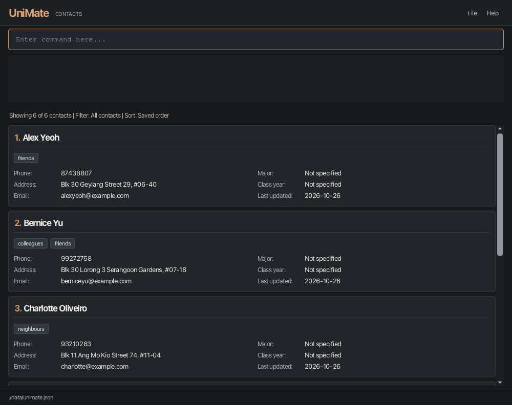
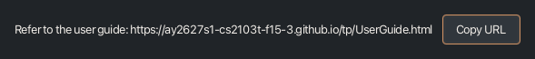
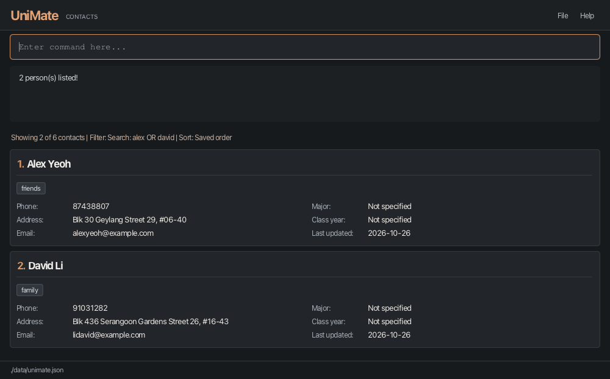

# UniMate User Guide

UniMate helps **university students organise contacts by major, class year and tags**.
It is a **desktop application for managing contacts, optimized for use through a Command Line Interface (CLI)** while retaining the benefits of a Graphical User Interface (GUI). If you type quickly, UniMate can help you manage contacts faster than traditional GUI applications.

This guide describes **v1.5 (unreleased)**. The published v1.4 JAR does not include all features below.
Use a matching v1.5 release when available; developers can [build the current source](DevOps.md#build-automation).

<!-- * Table of Contents -->
<page-nav-print />

--------------------------------------------------------------------------------------------------------------------

## Quick start

Run only one instance of UniMate at a time. Running multiple instances simultaneously is
unsupported and may overwrite saved changes.

1. Ensure that Java `25` is installed on your computer.
   **Mac users:** Ensure you have the precise JDK version prescribed [here](https://se-education.org/guides/tutorials/javaInstallationMac.html).
<br>
1. Download the v1.5 `unimate.jar`, once published, from the [UniMate releases page](https://github.com/AY2627S1-CS2103T-F15-3/tp/releases).

1. Copy the file to a writable folder you want to use as the _home folder_ for UniMate.

1. Open a terminal, `cd` to the folder containing the JAR file, and run `java -jar unimate.jar`.<br>
   A GUI similar to the one below should appear in a few seconds. Note how the app contains some sample data.<br>
   

1. Type a command in the command box and press Enter to execute it. For example, type **`help`** and press Enter to open the help window.<br>
   Some example commands you can try:

   * `list` : Lists all contacts.

   * `add n/John Doe p/98765432 e/johnd@example.com a/John street, block 123, #01-01` : Adds a contact named `John Doe` to UniMate.

   * `delete 3` : Deletes the 3rd contact shown in the current list.

   * `undo` : Reverts the most recent change to your contacts.

   * `clear` : Deletes all contacts.

   * `exit` : Exits the app.

1. Use the [Command summary](#command-summary) below for a quick reference, or see [Features](#features) for detailed instructions.

--------------------------------------------------------------------------------------------------------------------

## Command summary

Action     | Format, Examples
-----------|----------------------------------------------------------------------------------------------------------------------------------------------------------------------
**[Add](#adding-a-person-add)**    | `add n/NAME [p/PHONE_NUMBER] [e/EMAIL] a/ADDRESS [m/MAJOR] [c/CLASS_YEAR] [f/] [t/TAG]... [d/DEFAULT_INDEX]...` <br> e.g., `add n/James Ho p/22224444 e/jamesho@example.com a/123, Clementi Rd, 1234665 f/ t/friend t/colleague`
**[Clear](#clearing-all-entries-clear)**  | `clear`
**[Delete](#deleting-contacts-delete)** | `delete INDEX [INDEX]...`<br> e.g., `delete 1 3 5`
**[Edit](#editing-a-person-edit)**   | `edit INDEX [n/NAME] [p/PHONE_NUMBER] [e/EMAIL] [a/ADDRESS] [m/MAJOR] [c/CLASS_YEAR] [t/TAG]... `<br> e.g.,`edit 2 n/James Lee e/jameslee@example.com`
**[Find](#locating-persons-by-name-major-or-class-year-find)**   | `find KEYWORD [MORE_KEYWORDS]...`<br> e.g., `find James Jake`, `find Computer Science`, `find 2027`
**[Filter](#filtering-contacts-by-major-class-year-and-tag-filter)** | `filter [m/MAJOR] [c/CLASS_YEAR] [t/TAG]` (at least one criterion)<br> e.g., `filter m/Computer Science c/2027 t/Classmate`
**[Sort](#sorting-contacts-by-name-major-class-year-or-update-date-sort)**   | `sort FIELD DIRECTION` or `sort reset`<br> e.g., `sort name asc`, `sort major desc`, `sort year asc`, `sort updated desc`
**[List all saved contacts](#listing-all-persons-list)** | `list` (rejects extra arguments; clears the current filter and reports the total)
**[Favourite](#marking-a-favourite-contact-fav)** | `fav INDEX`<br> e.g., `fav 1`
**[Unfavourite](#removing-favourite-status-unfav)** | `unfav INDEX`<br> e.g., `unfav 1`
**[List favourites](#listing-favourite-contacts-listfav)** | `listfav`
**[Help](#viewing-help-help)**   | `help`
**[Tags](#listing-default-tags-tags)**   | `tags`
**[Tag](#adding-tags-to-a-person-tag)**    | `tag INDEX [d/DEFAULT_INDEX]... [t/TAG]...` (at least one tag)<br> e.g., `tag 1 d/2 t/NOC`
**[Untag](#removing-tags-from-a-person-untag)**  | `untag INDEX t/TAG [t/TAG]...`<br> e.g., `untag 1 t/NOC`
**[Note](#adding-or-replacing-a-contact-s-note-note)**   | `note INDEX TEXT`<br> e.g., `note 2 Met during CS2103T`
**[Show note](#viewing-a-contact-s-note-shownote)** | `shownote INDEX`<br> e.g., `shownote 2`
**[Delete note](#deleting-a-contact-s-note-delnote)** | `delnote INDEX`<br> e.g., `delnote 2`
**[Undo](#undoing-a-change-undo)**   | `undo`
**[Redo](#redoing-an-undone-change-redo)**   | `redo`
**[Exit](#exiting-the-program-exit)** | `exit`

--------------------------------------------------------------------------------------------------------------------

## Using the contact list

Contact details appear in two columns when the window is wide enough. In a narrow window, the academic
fields move below the phone, address and email fields.

* Long names and field values show `...` when they cannot fit. Click a shortened value to expand it,
  then click again to collapse it. This also applies to shortened tags.
* Use the scrollbar on the right of the contact list to reach other contacts or the bottom of an
  expanded card. Drag the thumb or use its arrow buttons for smaller movements.
* Expanding a value changes only its display; the saved contact details remain unchanged.
* Expanded values stay open while scrolling or resizing. Changing a contact resets its expanded
  values; restarting the app also resets expansion. A command that leaves the contact unchanged
  keeps its expansion state.

**Keyboard navigation**

| Key | Action |
| --- | --- |
| Tab from the command box | Focus the contact list, keeping the selection or selecting the first contact. |
| Up / Down while the list is focused | Select the previous / next contact. The selected card has an orange border. |
| Tab from the list | Focus the selected contact's first expandable value. If none exist, return to the command box. |
| Tab from an expandable value | Focus the next expandable value on that contact; after the last, return to the command box. |
| Shift+Tab from the command box | Focus the selected contact's last expandable value, or the list if none exist. |
| Shift+Tab from an expandable value | Focus the previous expandable value; before the first, return to the list. |
| Shift+Tab from the list | Return to the command box. |
| Enter / Space on an expandable value | Expand or collapse that value. |

Expandable values, including long tags, have an orange dotted outline when focused. Their order is:
name, tags from left to right, phone, address, email, major, class year, last updated. Short values and
other contacts are skipped. The list scrolls to keep the focused value visible; for a value taller
than the viewport, it shows the start of that value. With an empty list, Tab and Shift+Tab keep focus
in the command box.
Up/Down in the command box still recalls command history.

--------------------------------------------------------------------------------------------------------------------

## Features

<box type="info" seamless>

**Notes about the command format:**<br>

* Command words are case-insensitive: `tag`, `TAG` and `Tag` select the same command. This applies to all commands.<br>
  Parameter prefixes remain case-sensitive: use `t/`, not `T/`. Command arguments retain their original capitalization;
  Fixed sorting keywords also ignore case: `SORT Name ASC` works like `sort name asc`.

* Words in `UPPER_CASE` are the parameters to be supplied by the user.<br>
  For example, in `add n/NAME`, replace `NAME` with a value such as `John Doe`.

* Items in square brackets are optional.<br>
  For example, `n/NAME [t/TAG]` can be used as `n/John Doe t/friend` or as `n/John Doe`.

* Items followed by `...` can appear zero or more times.<br>
  For example, `[t/TAG]... ` may be omitted, or written as `t/friend` or `t/friend t/family`.

* Prefixed parameters can be in any order. For `sort`, the field must precede the direction.<br>
  For example, if the command specifies `n/NAME p/PHONE_NUMBER`, `p/PHONE_NUMBER n/NAME` is also acceptable.

* Extraneous parameters for `help`, `exit`, and `clear` are ignored.<br>
  For example, `help 123` is interpreted as `help`.

* `list`, `listfav`, `tags`, `undo` and `redo` take no parameters and reject extra arguments.<br>
  In particular, `list all` is rejected; use plain `list` to show all saved contacts.
  See [Listing all persons](#listing-all-persons-list) for details.

* If you are using a PDF version of this document, be careful when copying and pasting commands that span multiple lines as space characters surrounding line-breaks may be omitted when copied over to the application.
</box>

### Viewing help: `help`

Shows a message explaining how to access the help page.



Format: `help`


### Adding a person: `add`

Adds a person to UniMate.

Format: `add n/NAME [p/PHONE_NUMBER] [e/EMAIL] a/ADDRESS [m/MAJOR] [c/CLASS_YEAR] [f/] [t/TAG]... [d/DEFAULT_INDEX]...`

#### Field rules

| Field | Accepted value |
| --- | --- |
| Name `n/` | Required. English letters, digits and spaces; must not be blank. |
| Address `a/` | Required, non-blank text. See the prefix warning below. |
| Phone `p/` | Optional. At least three digits, without spaces, `+` or punctuation. |
| Email `e/` | Optional. `local-part@domain`; letters and digits with separated `+`, `_`, `.` or `-` in the local part, never at either end. Domain labels use letters/digits with separated internal hyphens; the final label has at least two characters. |
| Major `m/` | Optional, non-blank text on one line. |
| Class year `c/` | Optional. Four digits from `2000` to `2099`. |
| Tag `t/` | Optional. English letters and digits, without spaces. Repeat the prefix for multiple tags. |

Omit an optional field when unknown; do not supply an empty value in `add`.

For example, `add n/Alex Tan a/NUS m/Computer Science c/2027` creates a contact
without a phone or email. Use a name that is not already saved.

<box type="tip" seamless>

**Tip:** A person can have any number of tags, including zero.
Major and class year are optional and can be supplied independently.
</box>

<box type="warning" seamless>

**Check your field prefixes:** Use the prefixes shown in the command format above. Unknown prefix-like
text can become part of the preceding field instead of producing an error. For example,
`add n/PrefixProbe a/NUS x/typo` saves the address as `NUS x/typo`; `x/` does not start a separate field.

Recognised prefixes start a new argument when preceded by a space, even within text intended as an address.
In `add`, `f/` is a recognised flag: `add n/Alice a/Block f/` saves the address as `Block` and marks Alice
as a favourite. `add n/Alice a/Block f/3` is rejected because the flag has a value. Without a space before
`f/`, `add n/Alice a/Blockf/3` saves the full address `Blockf/3` and does not mark Alice as a favourite.
A space followed by `f/` is reserved for the flag and cannot be included as literal address text in `add`.

Check the added contact's details. To correct the `PrefixProbe` example, run `find PrefixProbe`, confirm the displayed
contact, then `edit 1 a/NUS`.
</box>

* Supply each single-value field only once. Leading and trailing spaces around values are ignored.
* The fields are saved with the contact, can be edited using `edit`, are shown in the displayed contact list and appear in command messages when specified.
**Duplicate names**

* A contact with the same name as an existing contact, ignoring case, is rejected as a duplicate, even if their major, class year or other details differ. For example, `John Doe` and `john doe` identify the same contact. Names retain their original capitalization for display and storage. Editing a contact's own name capitalization is allowed.
* A duplicate `add` error shows the existing contact's saved details. If the contact is visible,
  `Existing contact at displayed index N:` identifies its number in the current filtered and sorted list.
  If `filter`, `find` or `listfav` hides it, the error labels its number as a **saved index** and tells
  you to run `list`, then `sort reset`. After those commands, the contact is displayed at that index.
  A saved index should only be used for an indexed command after following those instructions and checking the card.
* Rejecting a duplicate leaves the current view, saved contacts and undo/redo history unchanged.
* Before opening an older data file, back it up. Give contacts whose names differ only in case
  distinct names; they are not automatically merged or renamed. See [data-file recovery](#editing-the-data-file)
  before continuing after a loading error.
* A successful `add` can be reverted with [`undo`](#undoing-a-change-undo).
**Favourite status**

* Include `f/` to create the contact as a favourite immediately, with a red heart beside their name.
  The flag takes no value, may appear anywhere among the prefixed fields, and may appear only once.
  Inputs such as `f/true` and `f/false` are rejected. Omit `f/` to create a contact without favourite status.
  Favourite status is saved with the contact and included in the same undo/redo step as the addition.
  The success message begins `New favourite contact added:` when `f/` is supplied, or `New person added:` otherwise.
  A flag with a value reports `The f/ flag does not take a value. Use f/ alone to mark the new contact as a favourite.`
* After creation, use [`fav INDEX`](#marking-a-favourite-contact-fav) or
  [`unfav INDEX`](#removing-favourite-status-unfav) to change favourite status. `edit` preserves the current
  favourite status and cannot change it.
* Phone and email are independently optional. Omit `p/` or `e/` when unknown; do not supply an empty prefix in `add`. Non-empty values must satisfy the existing phone and email format rules. A contact without either receives the [automatic incomplete reminder](#automatic-incomplete-reminders).
**Shared contact details**

* Adding a different name with a shared phone number or email succeeds with the usual
  `New person added: ...` feedback and an additional warning line in the same feedback box.
  For example: `Warning - duplicate details detected: #2 Alice (phone); #3 Bob (email)`.
  The complete message is amber when a warning is present; ordinary success feedback remains light grey.
  There is no coloured border or additional warning control.
  Every matching contact is listed by current displayed index and name, with `phone`, `email` or
  `phone and email` identifying the shared fields. The original feedback box supports wrapping, text
  selection and scrolling for the complete message. The next command replaces the previous feedback.
* Shared-detail warnings compare non-empty phone numbers exactly and email addresses ignoring case.
  Missing phone/email values do not count as shared details. These warnings do not change the
  duplicate-name rule or alter the stored capitalization of email addresses.
* A successful `add` shows the full contact list while retaining the current sort order. Warning
  indices refer to that refreshed list, including contacts hidden by the previous filter.

Examples:
* `add n/Alice p/91234567 a/NUS f/` creates Alice as a favourite; `listfav` includes Alice immediately.
* `add n/Alex Tan p/91234567 e/alex@example.com a/10 Kent Ridge Road m/Computer Science c/2027 t/classmate`
* `add n/John Doe p/98765432 e/johnd@example.com a/John street, block 123, #01-01`
* `add n/Betsy Crowe t/friend e/betsycrowe@example.com a/Newgate Prison p/1234567 t/criminal`
* After adding Alex Tan above, `add n/Study Partner p/91234567 a/NUS` adds the new contact and warns
  that Alex Tan shares its phone number. One `undo` removes the newly added Study Partner.

### Automatic incomplete reminders

UniMate shows an amber `incomplete` reminder when **both phone and email are missing**, so you can identify contacts without a recorded way to reach them. This is automatic: there is no `incomplete` command.

| Phone | Email | Reminder |
|-------|-------|----------|
| Present | Present | None |
| Present | Missing | None |
| Missing | Present | None |
| Missing | Missing | `incomplete` |

Address, major, class year, tags and notes do not affect this check. Missing phone and email values appear as `Not specified` on the contact card. A supplied phone still requires at least three digits; non-empty email values retain the existing email format requirements.

**Adding and clearing contact details:**

* `add n/Alice a/NUS` creates a contact without a phone or email and shows the reminder (assuming Alice does not already exist).
* `add n/Bob a/NUS p/91234567` records a phone only and has no incomplete reminder.
* `edit 1 p/91234567` or `edit 1 e/alice@example.com` supplies a contact method and removes the reminder immediately.
* `edit 1 p/` clears the phone; `edit 1 e/` clears the email. `edit 1 p/ e/` clears both, causing the reminder to appear. Omitted fields retain their values. As with the existing optional academic fields, empty prefixes clear fields only in `edit`; `add n/Alice a/NUS p/` is rejected.
* An actual contact-detail change refreshes `lastUpdated` and clears any outdated `update` reminder. If both contact methods are cleared, `incomplete` still appears even though the profile date is now current. Entering unchanged values does not reset the date.

**GUI and custom tags:**

Reminders use amber text on a dark brown background. Ordinary tags are grey, and favourite hearts remain red. `update` and `incomplete` may appear together, once each, when their independent conditions apply.

System reminders are not saved as ordinary tags. Removing a user tag with `untag` cannot remove the date-based or incomplete reminder. An existing custom tag named `incomplete` remains saved under its original name and is displayed as a grey tag labelled `incomplete (custom)`; manage it using `t/incomplete`. It can coexist with the amber reminder, just as `update (custom)` can coexist with `update`.

Phone/email values are saved normally. Older JSON files with valid contact details remain compatible; absent, null or empty phone/email fields are treated as unspecified. Other required fields and non-empty contact-value validation remain unchanged.

### Tracking a contact's latest update date

Every contact card shows `Last updated: YYYY-MM-DD` below the academic fields, including contacts
without an `update` reminder. For example, `Last updated: 2026-10-20` means the contact was added
or its basic information last changed on 20 October 2026. Use `list` to view all saved contacts and
their dates, or `find` and `filter` to narrow the displayed contacts. Use `sort updated asc` to review
the oldest updates first, or `sort updated desc` for the newest first.

* A new contact receives the date when `add` succeeds, using your computer's local date.
* A successful `edit` that changes the name, phone, email, address, major or class year records
  the current date. Clearing a previously specified optional field also counts as a change.
* Re-entering unchanged values, commands rejected before changing a contact, tag-only edits, notes,
  favourites and commands that only change the displayed list keep the previous date. The date measures maintenance of
  the contact's basic information, rather than changes to your personal annotations.
* Dates are saved automatically with the contacts and remain visible after restarting UniMate once saving succeeds.
  `undo` and `redo` restore the saved date belonging to the restored contact state.
* The date has day precision: several changes on the same day show the same date.

Example: run `list`, identify the displayed index of the contact, then enter `edit 1 p/91234567`.
If the first contact's phone changes, its card immediately shows today's date. If that phone was
already `91234567`, the previous date remains.

Contacts from older files without an update date show `Last updated: Unknown`. They stay last
in both ascending and descending update-date sorting until an actual basic-profile edit records a date.

### Automatic update reminders

UniMate automatically reminds you to check a contact whose basic information has not been updated for **more than one calendar year**. No new command or manual tag is required.

* An amber `update` label on a dark brown background appears beside the contact's grey ordinary tags. Favourite hearts remain red.
* The reminder is calculated from the contact's saved `lastUpdated` date. Exactly one year does not trigger it: if today is `2026-10-18`, a date of `2025-10-18` has no reminder, while `2025-10-17` does.
* New contacts start with today's date. Successfully changing the name, phone, email, address, major or class year through `edit` records today's date and removes the reminder. For example, `edit 1 p/98765432` clears the reminder if it changes the first displayed contact's phone number.
* Entering the same basic values again, editing only tags, changing notes, or using `tag`, `untag`, `fav`, `unfav`, `list`, `listfav` or `find` does not reset the date.
* Reminders are checked when cards are loaded or refreshed. Successful commands refresh the list; no background timer runs while the app is idle. The date is saved with the contact and retained across restarts. Undo and redo restore the recorded contact state, including its date.

**System reminders and custom tags:**

The amber `update` reminder is generated from the date and is never added to your ordinary tag collection. You cannot permanently remove it with `untag`; update the contact's basic information instead.

A custom tag named `update` is still supported and saved unchanged. It appears as a grey `update (custom)` tag to distinguish it from the amber system reminder. Use `t/update` to manage that custom tag as before. Adding or removing it does not create, overwrite or clear the system reminder. Both can be displayed together without duplicate system reminders.

**Older data files:**

Missing or null `lastUpdated` values remain unknown after saving and restarting. An unknown date does
not generate an age-based `update` reminder. A supplied invalid date is rejected rather than silently replaced.

### Listing default tags: `tags`

Displays the available default tags and their fixed indices:

1. Friend
2. Classmate
3. Teammate
4. Tutor
5. Prof

Format: `tags`

### Adding tags to a person: `tag`

Adds default or custom tags to an existing person without replacing their existing tags.

Format: `tag INDEX [d/DEFAULT_INDEX]... [t/TAG]...`

**Parameters:**

* `INDEX` is the person's position in the currently displayed list, including results from `find`. It must be a positive integer from `1` to `2147483647` and refer to a displayed person. Signs such as `+1`, zero, negative values and decimals are not accepted.
* `d/DEFAULT_INDEX` selects a default tag from `1` to `5`: `Friend`, `Classmate`, `Teammate`, `Tutor`, `Prof`, respectively. Use [the `tags` command](#listing-default-tags-tags) to view this list. The same integer syntax rules apply.
* `t/TAG` supplies a non-empty custom tag name containing only English letters (`A-Z`, `a-z`) and digits (`0-9`). Spaces within a name and punctuation are not allowed. Leading and trailing whitespace is trimmed.
* At least one `d/` or `t/` value is required. Both prefixes can be repeated and mixed in any order **after `INDEX`**. Separate each prefix from the preceding argument with a space.

Examples (assuming at least one person is displayed):

* `tag 1 d/2` adds `Classmate` to the first displayed person.
* `tag 1 d/1 d/3` adds `Friend` and `Teammate`.
* `tag 1 t/NOC` appends `NOC` without removing existing tags.
* `tag 1 t/NOC t/CCA d/2` appends two custom tags and `Classmate`.

**Expected behaviour:**

* The selected person's tags are updated; their other details and the current list filter are preserved.
* The result message starts with `Tagged person: `, followed by the person's name, phone, email, address, any specified major and class year, and updated tags. Tag display order is not guaranteed.
* Repeated tags and tags already attached to the person are stored only once. Adding an existing tag still returns the success message.
* Tag names retain their original capitalization and are case-sensitive: `NOC` and `noc` are different tags, even though command words are case-insensitive. This preserves existing user-defined categories without merging or changing stored tags. Default tags are stored by name in the same collection as custom tags: `d/1` and `t/Friend` select the same tag, whereas `t/friend` is different.
* Custom tags still use `t/` in `add` and `edit`. Unlike `tag`, `edit INDEX t/TAG` replaces the entire tag set.

**Error handling:**

| Input or situation | Result message |
|--------------------|----------------|
| Missing tags (`tag 1`), missing index, or invalid index syntax (`tag 0 t/NOC`, `tag x t/NOC`) | `Invalid command format!`, followed by the `tag` usage instructions. |
| A valid positive index outside the displayed list, with otherwise valid input | `The person index provided is invalid.` |
| Empty, non-integer or out-of-range default index (`tag 1 d/`, `tag 1 d/6`) | `Default tag index must be an integer from 1 to 5. Use tags to view them.` |
| Empty or invalid custom tag (`tag 1 t/`, `tag 1 t/NOC!`, `tag 1 t/two words`) | `Tag names should be alphanumeric` |

These input errors leave all contacts unchanged. If any supplied tag is invalid, none of the tags in that command are added. Use only `d/` and `t/`; unsupported prefixes are not ignored and may cause an index or tag validation error.

#### Viewing long tag names

Tag names longer than 20 characters initially show their first 20 characters followed by `...`.
Click a tag to expand or collapse its full name inside the card. You can also hover over it to see the
complete name in a tooltip; move the pointer away to close it. Tags may be shortened further when
space is limited.

This affects display only: the stored tag name and validation rules are unchanged. Use the complete original name with `tag`, `untag` or tag filtering, rather than the abbreviated display text. Custom tags that share a system-reminder name retain their `(custom)` marker.

### Removing tags from a person: `untag`

Removes specified tags from an existing person while preserving all other tags and contact details.

Format: `untag INDEX t/TAG [t/TAG]...`

**Parameters:**

* `INDEX` identifies a person in the currently displayed list and follows the same positive integer rules as [`tag`](#adding-tags-to-a-person-tag).
* At least one non-empty `t/TAG` is required. Names must contain only English letters and digits; leading and trailing whitespace is trimmed. Names are matched exactly, including case.
* Place `INDEX` first and separate each `t/` prefix from the preceding argument with a space. Repeat `t/` to remove multiple tags.
* `untag` does not accept `d/`. To remove a default tag, use its name, such as `t/Friend`.

Examples (assuming at least one person is displayed):

* `untag 1 t/NOC` removes `NOC` while keeping the person's other tags.
* `untag 1 t/NOC t/CCA` removes both tags.
* `untag 1 t/Friend` removes the default tag `Friend` by name.

**Expected behaviour:**

* The result message starts with `Untagged person: `, followed by the person's name, phone, email, address, any specified major and class year, and remaining tags. Tag display order is not guaranteed.
* The current list filter is preserved. Removing the last tag leaves the person with no tags; it does not delete the person.
* Repeated names and tags the person does not have are ignored. The command still returns the success message, even if no tags were removed. For example, `untag 1 t/noc` does not remove `NOC`.

**Error handling:**

| Input or situation | Result message |
|--------------------|----------------|
| Missing tags (`untag 1`), missing index, or invalid index syntax (`untag 0 t/NOC`) | `Invalid command format!`, followed by the `untag` usage instructions. |
| A valid positive index outside the displayed list, with otherwise valid input | `The person index provided is invalid.` |
| Empty or invalid tag (`untag 1 t/`, `untag 1 t/NOC!`) | `Tag names should be alphanumeric` |
| Unsupported default index syntax (`untag 1 d/1`) | `Invalid command format!`, followed by the `untag` usage instructions. |
| Unsupported prefix after a tag (`untag 1 t/NOC d/1`) | `Tag names should be alphanumeric` |

These input errors leave all contacts unchanged. If any supplied tag is invalid, none of the tags in that command are removed. Unlike `edit 1 t/`, `untag 1 t/` does not clear the tag collection.

For both commands, UniMate saves the updated data automatically. A saving failure reports `Could not save data due to the following error: ...` or `Could not save data to file ... due to insufficient permissions to write to the file or the folder.` If the tags changed, the message adds that the change has been applied but not saved to the local data file. The error does not mean the change was rolled back. See [Saving the data](#saving-the-data).

A `tag` or `untag` that changes a person's tags can be [undone](#undoing-a-change-undo) and [redone](#redoing-an-undone-change-redo). Adding a tag the person already has, or removing one they do not have, changes nothing and does not create an undo step.

### Marking a favourite contact: `fav`

Marks a person in the currently displayed list as a favourite.

Format: `fav INDEX`

* `INDEX` must be a positive integer from `1` to `2147483647` and refer to a person in the currently displayed list. Zero, negative numbers, a leading `+`, decimals and extra arguments are not accepted.
* The person's other details, tags, major and class year are preserved, together with the current list filter.
* A successful command shows `Added to favourites: ` followed by the updated person's details.
* A favourited contact displays a red heart (`♥`) beside their name. The icon is a visual indicator;
  use `fav` or `unfav` to change the status.
* Favourite status is saved automatically and retained after restarting UniMate. New contacts start as not favourited unless `f/` is included in `add`. Contacts loaded from older files without favourite status start as not favourited.
* Marking a favourite can be [undone](#undoing-a-change-undo) and [redone](#redoing-an-undone-change-redo).

Example (assuming at least one person is displayed):

* `fav 1` marks the first displayed person as a favourite and immediately shows the circular heart.

**Error handling:**

| Input or situation | Result message |
|--------------------|----------------|
| Missing or invalid index, or extra arguments (e.g., `fav`, `fav 0`, `fav 1 extra`) | `Invalid command format!`, followed by the `fav` usage instructions. |
| Index exceeds the displayed list size | `The person index provided is invalid.` |
| Person is already favourited | The selected contact's name followed by ` is already a favourite.`, e.g., `Alice is already a favourite.` |

These errors leave contact data unchanged.

### Removing favourite status: `unfav`

Removes favourite status from a person in the currently displayed list.

Format: `unfav INDEX`

* `INDEX` follows the same rules as [`fav`](#marking-a-favourite-contact-fav).
* A successful command shows `Removed from favourites: ` followed by the person's details, and the circular heart disappears immediately.
* All other contact fields are preserved. The updated favourite status is saved automatically and remains removed after restarting UniMate.
* When viewing favourites using `listfav`, the person immediately disappears from that filtered view. The contact remains stored and can be seen again using `list`.
* Removing favourite status can be [undone](#undoing-a-change-undo) and [redone](#redoing-an-undone-change-redo).

Example (assuming the first displayed person is favourited):

* `unfav 1` removes favourite status from that person.

**Error handling:**

| Input or situation | Result message |
|--------------------|----------------|
| Missing or invalid index, or extra arguments (e.g., `unfav`, `unfav -1`, `unfav 1 extra`) | `Invalid command format!`, followed by the `unfav` usage instructions. |
| Index exceeds the displayed list size | `The person index provided is invalid.` |
| Person is not favourited | The selected contact's name followed by ` is not a favourite.`, e.g., `Alice is not a favourite.` |

These errors leave contact data unchanged. After `unfav` removes a person from the favourite list, check the new displayed indices before entering another indexed command.

### Listing favourite contacts: `listfav`

Shows all favourited contacts in their existing order, with displayed indices starting at `1`. This replaces the previous search or list filter. Other contacts are hidden from the view, not deleted or modified.

Format: `listfav`

* No arguments are accepted. For example, `listfav 1` shows `Invalid command format!` followed by the `listfav` usage instructions, and leaves the current view unchanged.
* When favourites exist, the result is `Listed N favourite contact(s).`, where `N` is the number shown. Contact details and circular heart icons remain visible.
* If there are no favourites, the list is empty and the result is `No favourite contacts found.`

**Switching between lists:**

* The existing AB3 `list` command shows all contacts. The new `listfav` command shows only favourites. Both change the view without changing contact data or favourite status.
* `fav INDEX` and `unfav INDEX` always use the indices in the current view, including search results and the favourite list. A displayed index is not a permanent contact identifier.
* For example, run `list`, then `fav 1`, then `listfav`. Run `unfav 1` to remove the first person shown in the favourite list, then `list` to see all contacts again.
* The existing `add` and `edit` commands restore the full list after success. Run `listfav` again to return to favourites. Tag and untag operations preserve the current filter and favourite status.

### Adding or replacing a contact's note: `note`

Saves a short note for an existing contact. Each contact has one note; saving another replaces the previous text.

Format: `note INDEX TEXT`

* `INDEX` is the positive index shown in the current contact list, including search results.
* `TEXT` is required and must be a single line of up to 500 characters. Spaces, punctuation and Unicode text are allowed; control characters such as tabs are not.
* Leading and trailing whitespace, including non-breaking spaces (U+00A0), is trimmed before the
  500-character limit is checked. Spaces within the note, including Unicode spaces, are preserved.
* Everything after the index is note text. No field prefix or quotation marks are needed; text such as `n/` or `t/` is saved literally.
* The contact's other details and the current list filter are preserved.
* Notes are saved automatically with contact data and remain available after restarting UniMate. New contacts have no note; use `note` after `add`.
* Adding or replacing a note can be [undone](#undoing-a-change-undo) and [redone](#redoing-an-undone-change-redo). Saving the same text again does not create an undo step or clear any available redo history, because the note has not changed.

Example: `note 2 Met during CS2103T`

The message area identifies what happened and includes the saved text:

* A new note starts with `Note saved for NAME.`, followed by `Saved note: TEXT`.
* Replacing a different existing note starts with `Note replaced for NAME. Use undo to restore the previous note.`,
  followed by `Previous note: OLD_TEXT` and `Saved note: NEW_TEXT` on separate lines.
* Saving identical text starts with `Note unchanged for NAME.`, followed by `Saved note: TEXT`.
  This does not create an undo step or clear redo history.

For example, replacing `Met during CS2103T` with `Met at hackathon` for Alice displays:

```text
Note replaced for Alice. Use undo to restore the previous note.
Previous note: Met during CS2103T
Saved note: Met at hackathon
```

Long feedback wraps within the message area. Scroll vertically to compare the complete previous
and saved notes.

A small orange note icon at the top right of the contact card indicates that a note is present.
Use `shownote` to read it again.

### Viewing a contact's note: `shownote`

Displays the contact's note in the message area.

Format: `shownote INDEX`

Example: `shownote 2`

The message starts with `Note for NAME:`, followed by the saved text on the next line. If the contact has no note, it displays `No notes have been added to this contact.` Contact data, the current list filter, and undo/redo history are preserved.

### Deleting a contact's note: `delnote`

Removes the note from a contact while retaining the contact and all its other details.

Format: `delnote INDEX`

Example: `delnote 2`

The message area displays `Note deleted for NAME.`, and the note icon disappears. The current list filter is preserved. If the contact already has no note, the message is `This contact has no note to delete.` and its data stays unchanged.

Deleting an existing note can be [undone](#undoing-a-change-undo) and [redone](#redoing-an-undone-change-redo). Deleting an already empty note does not create an undo step or clear any available redo history.

For all three note commands, an index outside the displayed list reports `The person index provided is invalid.` Missing or invalid index syntax produces a usage error. `note INDEX` without text is also a usage error; use `delnote INDEX` to clear a note. `shownote` and `delnote` reject extra arguments. Invalid note text is rejected without changing the existing note.

### Listing all persons: `list`

Displays every contact currently saved in UniMate, including contacts loaded when you reopen the app.
Each contact card includes the person's name, tags, phone number,
address, email address, major, class year and [latest update date](#tracking-a-contact-s-latest-update-date).
Optional academic fields that have no saved value are displayed as
`Major: Not specified` or `Class year: Not specified`.

Format: `list`

* `list` takes no parameters. Leading and trailing whitespace is accepted, but `list all`, `list 1` and
  `list t/Friend` show `Invalid command format!` followed by usage instructions. A rejected command leaves the view unchanged.
* Replaces a `find`, `filter` or `listfav` view with the full saved contact list. Contacts hidden by those views are
  shown again with displayed indices starting at `1`; deleted contacts are not recovered.
* Retains the active `sort` order. Without an active sort, contacts appear in their saved order. Check the displayed
  indices again before using an indexed command such as `edit` or `delete`.
* Lists all saved contacts; it does not provide a recently added view or sort contacts by their creation date.
* The result starts with `Listed all persons.` and reports `N person(s) listed!` on the next line, where `N` is the
  total number of contacts displayed. An empty address book succeeds with `0 person(s) listed!`.
* Viewing contacts does not change their details, recorded update dates or undo/redo history. Saved contacts remain
  available after restarting UniMate from the same folder; active searches, filters and sort choices are temporary.

Examples:

* Run `find Alex`, then `list` to return from search results to every saved contact.
* Run `listfav`, then `list` to include non-favourites again.
* Run `sort name asc`, then `filter m/Computing`, then `list` to show all contacts in ascending name order.

### Editing a person: `edit`

Edits an existing person in UniMate.

Format: `edit INDEX [n/NAME] [p/PHONE] [e/EMAIL] [a/ADDRESS] [m/MAJOR] [c/CLASS_YEAR] [t/TAG]... `

For example, `edit 1 m/Mathematics` changes only the first displayed contact's major.
See the shared [field rules](#field-rules) for accepted values.

| Input | Effect |
| --- | --- |
| Omit a prefix | Keep its existing value. |
| `p/`, `e/`, `m/` or `c/` with no value | Clear that optional field. |
| Supply one or more `t/TAG` values | Replace the entire tag set. Use `tag` to add without replacing. |
| `t/` with no value | Remove all ordinary tags. |

Name and address cannot be cleared. Supply at least one field; `edit INDEX` alone is invalid.

* Edits the person at the specified `INDEX`. The index refers to the index number shown in the displayed person list. The index **must be a positive integer** 1, 2, 3, ...
* At least one of the optional fields must be provided.
* Existing values will be updated to the input values. Fields whose prefixes are omitted remain unchanged.
* Supply each single-value prefix only once.
* Leading and trailing spaces are ignored. If any supplied value is invalid or an academic prefix is repeated, no fields are updated.
* After a successful edit, the full contact list is shown while retaining the active sort order.
  If editing search or filter results, run `find` or `filter` again before using a result index for another edit.
* When editing tags, all of the person's existing tags are removed; adding tags is not cumulative.
* When the supplied `t/` values change the tag set, feedback includes `Tags replaced. Removed: ... . Added: ... .`
  with actual changes sorted by tag name (`None` for an empty list). Unchanged tags are excluded.
  For example, replacing `Friend` and `Classmate` with `Project` reports
  `Tags replaced. Removed: Classmate, Friend. Added: Project.`
  Use [`tag`](#adding-tags-to-a-person-tag) to add tags while keeping existing tags.
* Email local parts allow letters, digits and `+ _ . -`. Special characters cannot be consecutive
  or at either end: `alice++cs2103t@example.com` is rejected; `alice+cs2103t@example.com` is valid.
  Email errors show each rule on a short line, including the consecutive-special-character rule.
  Feedback wraps within the result display when the window is narrow.
* Clearing both phone and email shows the automatic `incomplete` reminder.
* A successful `edit` that changes the person's details can be reverted with [`undo`](#undoing-a-change-undo).
  Undo/redo messages retain the full `Edited person: ...` contact details without repeating the field or tag change summary or duplicate-details warning.
* The result display shows `Edited NAME:` followed by only the fields that actually changed,
  one per line in the form `Field: old value → new value`. Cleared optional fields show `Not specified`.
  Fields whose supplied values already match are omitted. Tag changes use the removal/addition summary above.
  The command box is cleared, and the contact card shows the resulting details.
* If all supplied values already match, the result is
  `No changes made to NAME. The supplied values match the existing details.`
  The contact's update date and undo/redo history are preserved; no undo step is created and available redo
  remains available. The full contact list is still shown and the command box is cleared.
* Changing a phone number or email to one used by another contact keeps the field change summary
  and appends a line such as `Warning - duplicate details detected: #2 Alice (phone); #3 Bob (email)`.
  If the tags also change, the tag replacement summary appears between the field change summary
  and the warning; neither is dropped. The complete message appears amber in the original feedback
  box, without a coloured border or an additional warning control. Feedback without a warning remains
  light grey, including tag-only edits. Indices identify matching contacts in the refreshed full list,
  including matches hidden before the edit. The edited contact's updated name and details remain in
  the field change summary. All matches are retained; long feedback wraps and can be scrolled.
* Warning comparisons match non-empty phone numbers exactly and email addresses ignoring case.
  Only methods whose values changed are checked. Unchanged values, email-capitalization-only changes,
  unrelated field edits, cleared methods and the edited contact itself do not trigger a warning.
  The edit is saved normally, and one `undo` restores the previous contact. Undo and redo use ordinary
  edit feedback without repeating the warning.
* Notes and favourite status are preserved. Use [`fav INDEX`](#marking-a-favourite-contact-fav) or
  [`unfav INDEX`](#removing-favourite-status-unfav) to change favourite status; it cannot be changed with `edit`.
  Changing a basic profile field refreshes the contact's update date;
  changing only tags does not refresh that date.
* Invalid input, an index outside the displayed list, or a name already used by another contact leaves the
  contacts and current view unchanged. The result display shows the error and the command box keeps the input for correction.

If saving fails, the result display reports a saving error and keeps the command text. The in-memory
edit has already happened; the error does not mean it was rolled back.

Examples:
*  `edit 1 p/91234567 e/johndoe@example.com` Edits the phone number and email address of the 1st person to be `91234567` and `johndoe@example.com` respectively.
*  `edit 1 m/Computer Science c/2027` Updates the 1st person's major and graduation year.
*  `edit 1 m/ c/` Clears both academic fields while keeping the other details.
   If Alice Tan previously had major `Computer Science` and class year `2027`, feedback is:

   ```text
   Edited Alice Tan:
   Major: Computer Science → Not specified
   Class year: 2027 → Not specified
   ```

   Repeating the command reports `No changes made to Alice Tan. The supplied values match the existing details.`

*  `edit 1 e/ALICE@example.com` changes `alice@example.com` to the supplied capitalization.
   Feedback includes `Email: alice@example.com → ALICE@example.com` and the profile date is refreshed.
   Email matching ignores case, so this capitalization-only edit does not introduce a shared-email warning.

*  `edit 2 n/Betsy Crower t/` Edits the name of the 2nd person to be `Betsy Crower` and clears all existing tags.

<!-- @@author Chan Lok Tung -->

### Locating persons by name, major or class year: `find`

Finds contacts by name, major or class year.

Format: `find KEYWORD [MORE_KEYWORDS]...`

1. Type at least one word to search for. Separate words with spaces.
- `find` on its own shows an error, and the list stays the same

2. Capital letters do not matter.
- `hans` is the same as `Hans`

3. Only names, majors and class years are searched. Phone numbers, emails, addresses, tags and notes are not.
- `find friends` does not find a contact tagged `friends`. Use [`filter t/friends`](#filtering-contacts-by-major-class-year-and-tag-filter) instead.

4. Only whole words match.
- `Han` does not find `Hans`
- `Comp` does not find `Computer Science`
- `27` does not find the class year `2027`

5. Punctuation counts as part of a word.
- for the major `Computer Science (Hons)`, `find Hons` finds nothing, but `find (Hons)` works

6. A contact is shown if it matches **any** of your words. The order of your words does not matter.
- `find Hans Bo` shows both `Hans Gruber` and `Bo Yang`
- `find Computer Science` also shows contacts majoring in `Data Science`

7. Do not type prefixes such as `n/` or `m/`. They are treated as part of the word.
- `find n/Alex` usually finds no one

8. Contacts with no major or class year cannot be found by those fields. Searching for `Not specified` does not find them.

9. Every search looks through **all** your contacts, not just the ones on screen.
- it replaces the results of your previous `find`, `filter` or `listfav`
- your [`sort`](#sorting-contacts-by-name-major-class-year-or-update-date-sort) order is kept

10. UniMate shows how many contacts were found, such as `2 person(s) listed!`. The line above the list shows what you searched for.
- `Filter: Search: alex OR david`

11. The results are numbered from `1`. Use these numbers in commands such as `edit`, `delete` and `fav`.
- run [`list`](#listing-all-persons-list) to see all your contacts again

12. Searching never changes your contacts, so it does not affect [`undo`](#undoing-a-change-undo) or [`redo`](#redoing-an-undone-change-redo).

Examples:
* `find John` shows `john` and `John Doe`
* `find Computer Science` shows contacts majoring in `Computer Science`, `Computer Engineering` or `Data Science`
* `find 2027` shows contacts in the class of `2027`
* `find alex david` shows `Alex Yeoh` and `David Li`<br>
  

<box type="tip" seamless>

**Tip:** To show only contacts whose major is exactly `Computer Science`, use [`filter m/Computer Science`](#filtering-contacts-by-major-class-year-and-tag-filter) instead.
</box>

<!-- @@author -->

### Filtering contacts by major, class year and tag: `filter`

Shows contacts whose complete field values match **all** supplied criteria (AND matching).

Format: `filter [m/MAJOR] [c/CLASS_YEAR] [t/TAG]`

* Supply at least one criterion. Each prefix may appear only once, in any order, separated by spaces.
* Major and tag matching ignore case but require the complete value: `m/Computer Science` matches
  `Computer Science`, while `m/Computer` does not. A tag criterion matches any one of the contact's tags.
* Class year matches exactly and must be four digits from `2000` to `2099`.
* Omitted criteria leave those fields unrestricted. An unspecified academic field does not match a
  supplied criterion for that field, but the contact can still match a criterion on another field.
* Leading and trailing spaces around values are ignored; spaces within a major remain significant.
* Blank values, repeated prefixes, unsupported single-letter prefixes and invalid values produce an
  error without changing the current results. Use `t/Friend` to filter a default tag; `d/` is not supported.
* The result message shows the number of matching contacts. Zero matches displays an empty list;
  no contacts are deleted.
* A persistent status line above the contact list shows the displayed/total contact counts, active
  filter or search, and sort order. For example:
  `Showing 3 of 20 contacts | Filter: Class year: 2027 | Sort: Name ascending`.
  It stays visible when another command, such as `shownote`, replaces the result message.
  Long criteria wrap onto additional lines. The status also identifies favourites views and empty results.
* Each `filter` replaces the previous search or filter and retains the active sort order, or the saved
  contact order if no sort has been chosen. `find` replaces the filter; `list` shows all contacts again.
* Indices refer to the currently displayed list. For example, `delete 1` targets the first filtered result.
  Deleting or untagging a contact that no longer matches removes it from the results and renumbers the list.
* Successful `add`, `edit`, `undo` and `redo` commands show the full list.
  Reapply the filter before using a filtered index again. Tag and untag retain the active filter.
* Filters are temporary: restarting UniMate shows the full contact list. Filtering does not create
  an undoable data change or clear redo history.

Examples:
* `filter m/Computer Science c/2027 t/Classmate` shows contacts who match all three criteria.
* `filter c/2027` shows all contacts with class year `2027`, regardless of their major or tags.
* `filter t/friend` shows contacts with a complete tag matching `friend`, ignoring case.
* `list` returns to the full contact list.

Unlike `find Computer Science`, which searches for either word across names and academic fields,
`filter m/Computer Science` checks only the complete major value.

### Sorting contacts by name, major, class year or update date: `sort`

Orders the displayed contacts while keeping the current search or filter.

Format: `sort FIELD DIRECTION` or `sort reset`

* To choose a sort order, both arguments are required and must appear in this order. Keywords are case-insensitive; for example, `sort Name ASC` is accepted.
  Extra surrounding spaces and spaces between arguments are allowed.

  | Argument | Accepted values | Meaning |
  | --- | --- | --- |
  | `FIELD` | `name`, `major`, `year`, `updated` | Full name, full major, graduation year or latest update date |
  | `DIRECTION` | `asc`, `desc` | A–Z / earliest first, or Z–A / latest first |

* Names and majors are compared case-insensitively. Class years and update dates are ordered chronologically.
  For `updated`, `asc` puts the oldest dates first and `desc` puts the newest dates first.
  Contacts with the same date use ascending, case-insensitive name order in both directions.
  Contacts with unknown update dates stay last in both directions.
* Contacts with an unspecified major or class year appear **last** when sorting by that field,
  for both directions. Equal academic values, including unspecified values, use ascending name order.
  Names differing only in case compare equally.
* `sort reset` removes the active sort and restores saved contact order, while keeping the current
  search or filter. It takes no direction or other arguments and succeeds even if no sort is active.
  Unlike `sort reset`, `list` removes the filter and keeps the current sort. Use `list`, then
  `sort reset`, to show all contacts in saved order.
* Sorting an empty list or a single contact succeeds. Sorting does not add or remove contacts.
* `filter`, `find` and `list` retain the chosen sort order. A successful `add`, `edit`, `undo` or `redo`
  shows all contacts in that order; tag, untag and delete retain the current filter and sort.
  Changing a sorted field can move a contact to a new position.
* Numbered commands use the **currently displayed order**. Check the latest card numbers before
  using `edit`, `delete`, `tag` or `untag`; sorting and contact changes can renumber the list.
* Missing arguments, unsupported fields or directions and extra arguments produce
  a usage error without changing the current results or saved data.
* Sorting is temporary. It does not reorder saved contacts, create an undoable change or clear redo history.
  Restarting restores the saved contact order and shows all contacts.

Examples:
* `sort name asc` displays names from A to Z.
* `sort major desc` displays majors from Z to A, with unspecified majors last.
* `sort updated asc` brings contacts whose basic information has not changed for the longest time to the top.
  `sort updated desc` shows the most recently added or updated contacts first. Several updates on the same day
  share a date; this does not order individual changes within that day.
* `filter c/2027`, then `sort name asc`, then `sort reset` shows only class year `2027` contacts
  in saved order. The status changes from `Sort: Name ascending` to `Sort: Saved order`.
* `filter t/Classmate`, then `sort year asc`, shows only classmates, earliest class year first.
  `list` then shows all contacts in the same year order.

### Deleting contacts: `delete`

Deletes one or more specified contacts from UniMate.

Format: `delete INDEX [INDEX]...`

* Supply one or more **distinct positive integers** separated by spaces, such as `delete 1 3 5`.
  Commas and ranges such as `delete 1,3` and `delete 1-3` are not accepted.
* Every index refers to the filtered and sorted list displayed **before the command starts**.
  For example, `delete 1 3 5` removes the original 1st, 3rd and 5th displayed contacts, even as the
  remaining cards are renumbered. Indices can be supplied in any order, such as `delete 5 1 3`.
* Every index is checked before any contact is deleted. If any index is invalid or repeated, the
  whole command is rejected. For example, `delete 1 1` reports
  `Index 1 is repeated. Specify each displayed index only once. No contacts were deleted.`
* An index beyond the displayed list is rejected with the valid range for that view. For example, if
  `find Alpha` displays one contact, `delete 2` reports
  `Index 2 is outside the current displayed list. No contacts were deleted. The only valid index is 1.`
  If three contacts are displayed, `delete 1 3 4` reports that index 4 is out of range and states
  `No contacts were deleted.` Contacts 1 and 3 remain present too.
* If no contacts are displayed but saved contacts exist, the error suggests `list` to show them.
  If there are no saved contacts, it suggests adding a contact first. Rejected commands leave contacts,
  the displayed list and undo/redo history unchanged.
* Deleting one contact keeps the `Deleted person: ...` feedback. Deleting several contacts reports
  `Deleted N contacts:`, followed by their details on separate lines, labelled with their original
  displayed indices in the order you entered them. Major and class year are included when specified.
* Deletion preserves the current filter and sort order. Contacts outside the displayed results are unaffected.
* One [undo](#undoing-a-change-undo) restores the entire batch, and one
  [redo](#redoing-an-undone-change-redo) deletes that batch again.

Examples:

* `list` followed by `delete 2` deletes the 2nd person in UniMate.
* `list` followed by `delete 1 3 5` deletes the original 1st, 3rd and 5th displayed contacts together.
* `find Betsy` followed by `delete 1` deletes the 1st person in the results of the `find` command.
* `filter t/Classmate`, then `sort name asc`, then `delete 1 3` deletes the original 1st and 3rd
  classmates in ascending name order, provided at least three results are displayed.
* Deleting a contact with academic fields shows a message such as
  `Deleted person: Alex Tan; Phone: 91234567; Email: alex@example.com; Address: 10 Kent Ridge Road; Major: Computer Science; Class year: 2027; Tags: [classmate]`.

### Clearing all entries: `clear`

Clears all entries from UniMate.

Format: `clear`

<box type="warning" seamless>

**Caution:** `clear` removes all your contacts. You can bring them back with [`undo`](#undoing-a-change-undo), but only while UniMate is still open: undo history is cleared when you close UniMate.
</box>

<!-- @@author Chan Lok Tung -->

### Undoing a change: `undo`

##### Takes back your most recent change to your contacts.

Format: `undo`

1. You can undo any command that changes your contacts:
- `add`, `edit`, `delete` and `clear`
- `tag`, `untag`, `fav` and `unfav`
- `note` and `delnote`

2. Each `undo` takes back one command. Run it again to go further back, one change at a time. There is no limit.
- `delete 1 3 5` and `clear` are each taken back in a single `undo`

3. UniMate tells you which change was undone.
- `Undid: Tagged person: …​`
- `Undid: Deleted person: Alex Tan; …​`
- the message shows the details from when you made the change, not the details brought back. Check the contact list to see what was restored
- for `edit`, the message lists the contact's full details instead of only what changed

4. After an undo, all your contacts are shown. Any search or filter is cleared, but your sort order is kept.
- check the contact numbers again before your next command

5. Commands that did not change anything are skipped, and `undo` takes back the change before them.
- `edit` with the same details, `tag` with a tag the contact already has, or `clear` on an empty list
- commands that failed, such as adding a duplicate contact
- commands that only show contacts, such as `list`, `find`, `filter`, `sort`, `listfav`, `shownote`, `tags` and `help`

6. Do not type anything after `undo`.
- `undo 1` shows an error, and nothing is undone

7. If there is nothing to undo, UniMate shows `There is no change to undo.`

8. Undo only works while UniMate is open. Closing UniMate clears your undo history.

9. Your contacts are saved automatically after an undo.
- if a command showed a save error, the change was still made, so `undo` can take it back. See [Saving the data](#saving-the-data)

Examples:
* `add n/Alex Tan p/91234567 e/alex@example.com a/10 Kent Ridge Road`, then `undo`, removes `Alex Tan`.
* `edit 2 p/98765432`, then `undo`, brings back the 2nd contact's old phone number.
* `note 1 Follow up`, then `note 1 Project teammate`, then `undo`, brings back the note `Follow up`.
* `delnote 1`, then `undo`, brings back the deleted note.
* `delete 1 3 5`, then `undo`, brings back all three contacts at once.
* `fav 1`, then `tag 2 t/Friend`, then `undo` twice: the first `undo` removes the `Friend` tag, and the second removes the favourite.

### Redoing an undone change: `redo`

##### Brings back a change you undid.

Format: `redo`

1. Each `redo` brings back one undone change, starting with the one you undid last.
- run `redo` again to bring back more, in the order you first made them
- you can undo a redone change again

2. UniMate tells you which change was redone, in the same way as `undo`.
- `Redid: Added to favourites: …​`

3. After a redo, all your contacts are shown. Any search or filter is cleared, but your sort order is kept.

4. You can only redo until you make a new change. After a new change, such as `add`, `delete` or `fav`, your undone changes are gone, even if you undo the new change.
- `tag 1 t/Friend`, `undo`, `fav 2`, `undo`, then `redo` brings back only the `fav`. The tag cannot be redone

5. Commands that failed, did not change anything, or only show contacts do not affect `redo`.

6. Do not type anything after `redo`.
- `redo 1` shows an error, and nothing is redone

7. If there is nothing to redo, UniMate shows `There is no change to redo. An undone change cannot be redone after another change has been made.`

8. Redo only works while UniMate is open. Your contacts are saved automatically after a redo.

Examples:
* `add n/Alex Tan p/91234567 e/alex@example.com a/10 Kent Ridge Road`, then `undo`, then `redo`, adds `Alex Tan` back.
* `edit 1 p/91234567`, then `undo`, then `redo`, changes the 1st contact's phone number to `91234567` again.
* `delnote 1`, then `undo`, then `redo`, deletes the note again.
* `clear`, then `undo`, then `redo`, clears your contacts again.

<box type="tip" seamless>

**Tip:** If you undo a change by mistake, run `redo` straight away, before making any other change.
</box>

<!-- @@author -->

### Exiting the program: `exit`

Exits the program.

Format: `exit`

### Navigating command history

With the command box focused, press **↑** to recall the most recently submitted command.
Press **↑** again to browse older commands, or **↓** to browse newer commands.
After the newest command, **↓** restores the draft you were typing before browsing.
At the oldest command, further **↑** presses keep that command displayed.

While browsing, a label beside the command box shows **History i/N**, where **1** is the oldest
submission and **N** is the newest. Repeated identical commands occupy separate positions, so three
`list` submissions show **History 3/3**, **2/3**, then **1/3** as you press ↑. The label briefly pulses
on every history arrow press, including ↑ at the oldest entry, even when the command text stays the
same. It disappears when you return to your draft or press Enter, including a failed submission.
At the draft or with empty history the label stays hidden. Prefix search uses the same absolute
positions among all submissions, so its displayed numbers may skip unrelated entries.

Commands are recorded when you press Enter, including unsuccessful commands and repeated submissions.
Empty input is not recorded. You can edit a recalled command and press Enter to submit it again;
browsing alone does not execute commands. Edits made while browsing are not saved in the history.
History is cleared when you close UniMate.

With no history, either arrow leaves your input unchanged. After the draft has been restored, further
**↓** presses leave it unchanged. Recalled text places the caret at the end; the contact list and result
message stay as they were until you submit a command. A successful submission clears the command box;
a failed submission keeps the text for correction and can still be recalled.

For example, submit `list`, then `find Alice`. Type `edit 1 m/` without pressing Enter.
Press **↑** twice to see `find Alice` then `list`; press **↓** twice to return through `find Alice`
to your draft `edit 1 m/`. None of these arrow presses executes a command.

For optional prefix search, type a prefix such as `add ` (including the space), then press
**Alt+↑** (**Option+↑** on macOS) to skip unrelated commands and recall older matching entries.
**Alt+↓** (**Option+↓**) browses newer matches and restores your original draft after the last match.
Matching is case-sensitive and includes spaces; an empty prefix matches all commands. Repeated shortcut
presses keep the initial prefix. At the oldest match, or when there is no match, the input stays unchanged.
Alt+↓ without an active search leaves input unchanged. Editing the text starts a new prefix search from
that text at the current history position. Ordinary ↑/↓ continues chronologically from the current
position and ends the prefix search. Both navigation modes preserve the draft saved when you first
left the end of history, and neither executes commands.

For example, submit `add n/Alice a/NUS`, `list`, `add n/Bob a/NUS`, then `list`. Type `add ` without pressing Enter.
Alt+↑ recalls `add n/Bob a/NUS`, then `add n/Alice a/NUS`; Alt+↓ recalls `add n/Bob a/NUS`, then restores `add `.

To check the position label, start a fresh session and submit `list`, `find Alice`, then `list`.
Type `li` and press Alt+↑ twice: the label shows **History 3/3**, then **History 1/3**.
Pressing Alt+↑ again keeps **History 1/3** and pulses the label. Alt+↓ returns to **History 3/3**;
the next Alt+↓ restores `li` and hides the label. These numbers count all submissions, including
`find Alice`, rather than only the two matches. This session's command recall is separate from
[`undo`](#undoing-a-change-undo), which restores contact data.

### Saving the data

UniMate automatically saves data after every command. You do not need to save manually.

If UniMate cannot write the data file, for example because the file or its folder is read-only, the command still takes effect inside UniMate. Instead of the usual success message, the result box shows one of these errors:

* `Could not save data to file ... due to insufficient permissions to write to the file or the folder.`
* `Could not save data due to the following error: ...`

If the command changed your contacts, the error explains that the change was applied but not saved,
how to revert it, and how to save it after fixing the problem. It names `undo` to revert an ordinary
change, or `redo` after a failed `undo`. A command that leaves contacts unchanged, such as `list`,
does not add this unsaved-change explanation.

The contact list shows the change, and `undo` treats it like any other change. Only the copy on your disk is out of date.

<box type="warning" seamless>

**Caution:** A save error does **not** mean your command was cancelled. Do not run `undo` to "retry" or "cancel" it: `undo` would revert the change, showing `Undid:` followed by that change's message. Instead, fix the cause (such as making the data file writable), then run any command that succeeds, such as `list`. UniMate then saves all your current contacts, including the earlier change. If you close UniMate before a save succeeds, changes made since the last successful save are lost.
</box>

### Editing the data file

UniMate saves contacts in `data/unimate.json`, relative to the folder from which you launch it.
Use `cd` to enter your chosen home folder before launching UniMate to keep this location predictable.
Advanced users can edit that file while UniMate is closed; back it up first.

<box type="warning" seamless>

**Caution:**
If your changes make the data file invalid, UniMate starts with an empty contact list at the next run. The invalid file remains on disk until you run a command that executes successfully (including `list` or `help`). Still, we recommend backing up the file before editing it.<br>
Furthermore, certain edits can cause UniMate to behave in unexpected ways (e.g., if a value entered is outside of the acceptable range). Therefore, edit the data file only if you are confident that you can update it correctly.
</box>

A file containing only `null`, a null contact entry such as `{"persons":[null]}`, or a null tag entry
such as `"tags":[null]` is invalid. UniMate rejects the whole file, logs the loading error and opens
with an empty contact list. For null contact or tag entries, the logged error identifies their
positions, counting from 1 in the saved arrays (not the GUI's displayed order). Close the window
without running a command before repairing or restoring the file. A valid empty address book
(`{"persons":[]}`) and omitted optional contact fields remain supported.

--------------------------------------------------------------------------------------------------------------------

## Coming soon

The following feature is planned for a future release and is not currently available.

### Archiving data files `[coming in v2.0]`

Planned only; there is no archiving command in the current release.

--------------------------------------------------------------------------------------------------------------------

## FAQ

**Q**: How do I transfer my data to another computer?<br>
**A**: Install the same UniMate version on the other computer. Close UniMate on both computers and
back up both data files. Copy `data/unimate.json` from the old launch folder into the new launch
folder's `data` directory, replacing its file. Reopen UniMate and check your contacts before deleting
the backup. See [Editing the data file](#editing-the-data-file) for the file location.

--------------------------------------------------------------------------------------------------------------------

## Known issues

1. **When using multiple screens**, if you move the application to a secondary screen, and later switch to using only the primary screen, the GUI will open off-screen. The remedy is to delete the `preferences.json` file created by the application before running the application again.
2. **If you minimize the Help Window** and then run the `help` command (or use the `Help` menu, or the keyboard shortcut `F1`) again, the original Help Window will remain minimized, and no new Help Window will appear. The remedy is to manually restore the minimized Help Window.
3. **If saving the data file fails**, the command's change is still applied inside UniMate. The save error replaces the usual success message, and says that the change is applied but not saved. Running `undo` at this point reverts that change. The remedy is to fix the cause of the error and then run any successful command, such as `list`, to save your contacts. See [Saving the data](#saving-the-data).
